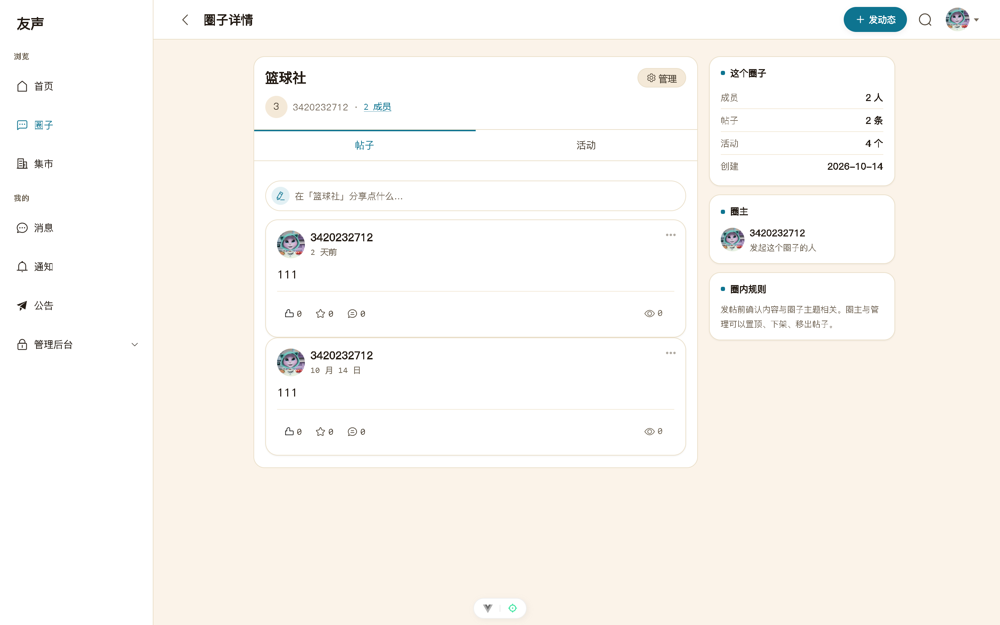
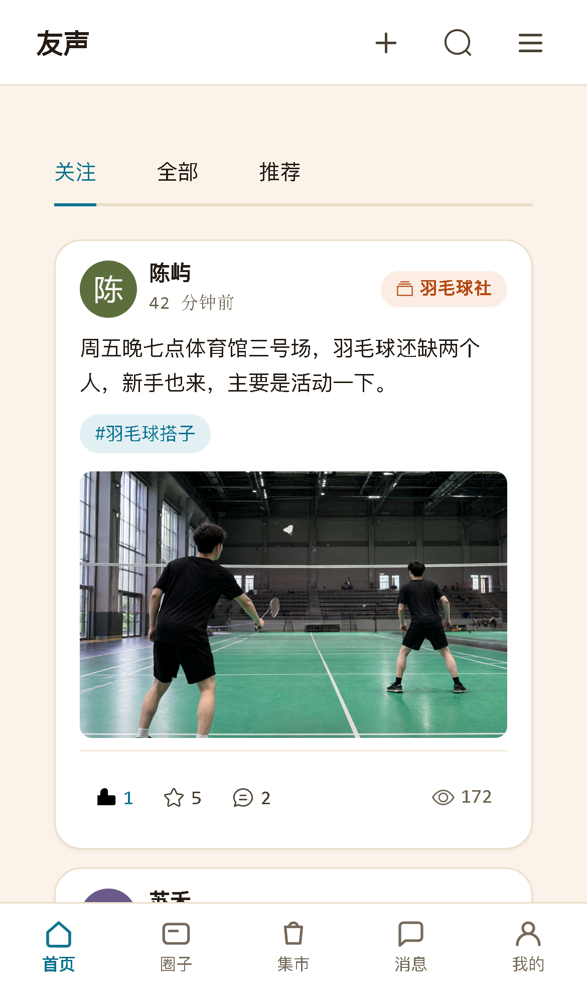
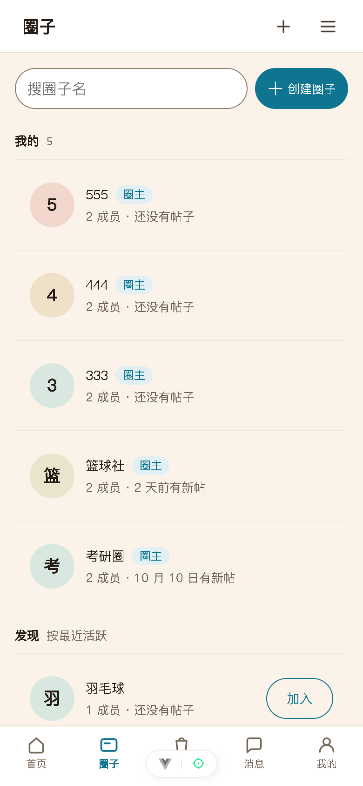
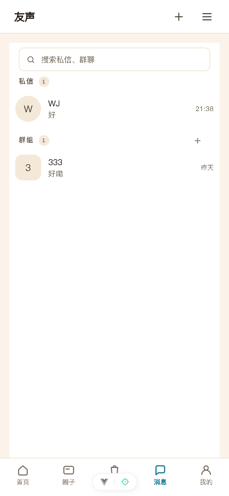
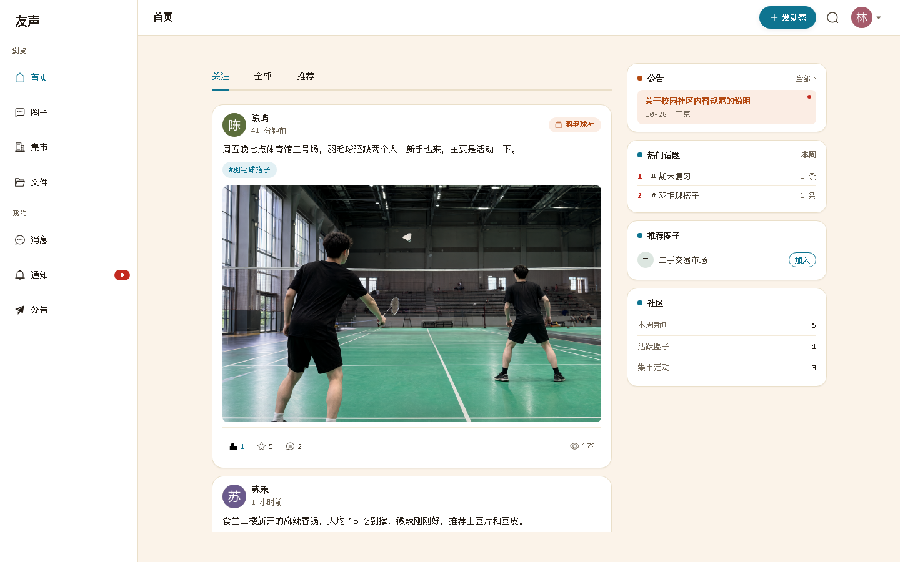
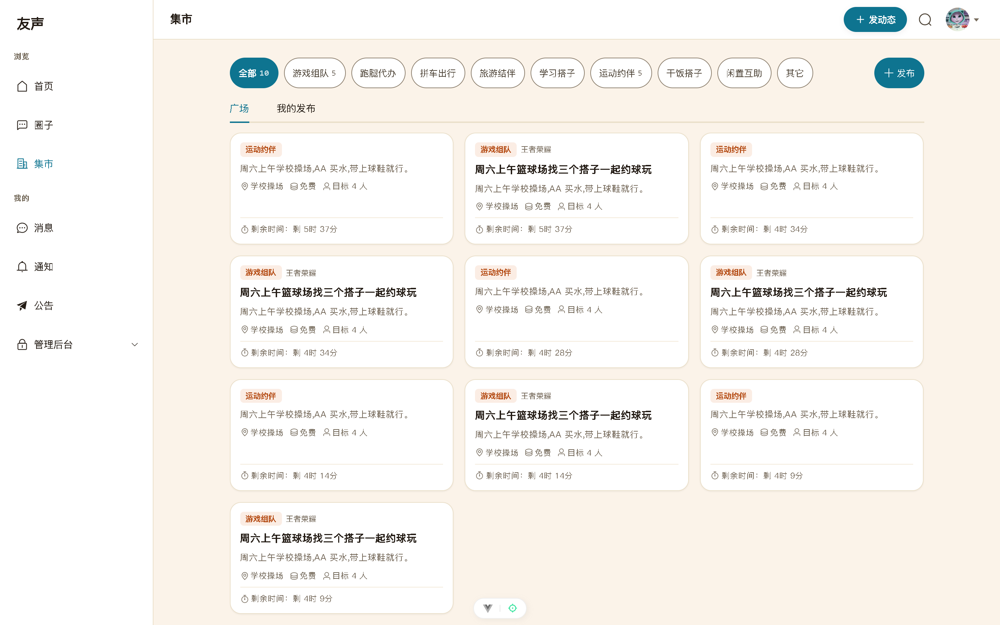
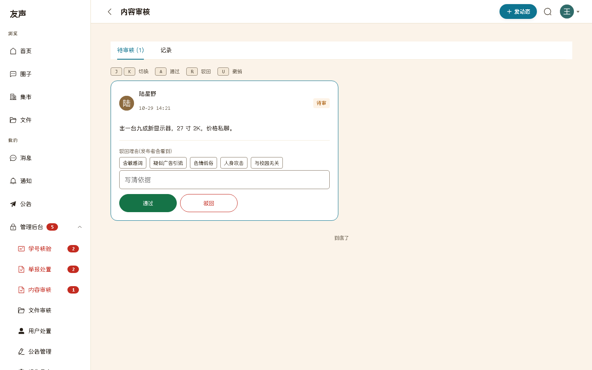
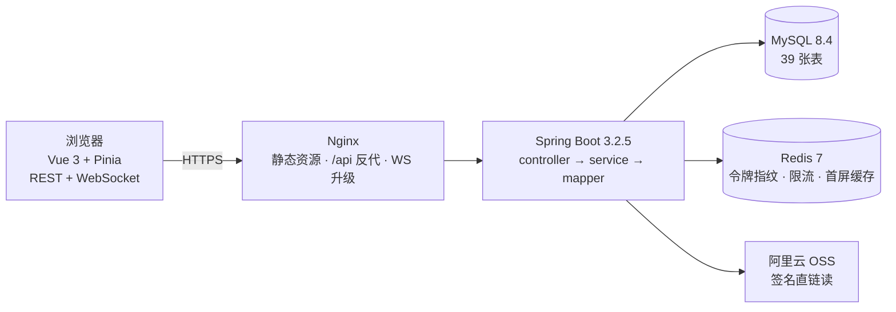

<div align="center" markdown="1">

# 友声

**嘤其鸣矣，求其友声。**<br>——《诗经 · 小雅 · 伐木》

一个面向高校的校园生活社区：动态、圈子、活动、集市、私信、公告、搜索，含完整管理后台。

### [🌐 yousheng8.cn](https://yousheng8.cn)

[](https://yousheng8.cn)
[](https://github.com/wj20040628/campus-social/actions/workflows/ci.yml)
[](frontend/package.json)
[](LICENSE)


</div>

---

## 它能解决什么

校园社交的真正难点不在「发帖」，而在三件事：**身份不可信**（谁都能冒充学生）、**信息易刷屏**（没有治理的校园墙三个月就沦为广告板）、**内容无人管**（个人开发者没有审核团队）。友声围绕这三件事做取舍：

| 校园里的真实场景 | 友声的做法 |
| --- | --- |
| 想确认对方是不是本校学生 | 校园信息（学院 / 专业 / 年级）选填登记，学号只校验格式与唯一性；注册时间与信誉分决定能否搭话等高风险操作 |
| 想找同好，不想泡在全校大群里 | **圈子**：圈主 / 圈管理 / 成员三级自治，圈内帖子与线下活动 |
| 想约一场球，凑不齐人 | **活动**：名额上限 + 只增不超的报名，防并发超卖 |
| 想把闲置书卖掉 | **集市**：同校范围内的二手与招募，带风险提示与投放时长 |
| 被骚扰、被造谣 | 举报 → 管理员待办 → 下架 / 禁言 / 封禁 / 解散，全程留痕并回执举报人 |
| 担心帖子被人扒到个人信息 | 学号、邮箱不出现在任何前台响应，脱敏收敛在唯一装配器出口 |

## 界面

> 以下为本地真实运行截图（演示数据），桌面端不是把手机界面拉宽，而是重新组织信息层级。



<table>
<tr>
<td width="25%" align="center"><br><sub><b>首页 · 关注/全部双流</b></sub></td>
<td width="25%" align="center"><br><sub><b>圈子广场</b></sub></td>
<td width="25%" align="center"><br><sub><b>帖子详情与评论</b></sub></td>
<td width="25%" align="center"><br><sub><b>私信会话</b></sub></td>
</tr>
</table>

<table>
<tr>
<td width="33%" align="center"><br><sub><b>首页 · 桌面三栏</b></sub></td>
<td width="33%" align="center"><br><sub><b>集市 · 分类与剩余时间</b></sub></td>
<td width="33%" align="center"><br><sub><b>内容审核台 · 机审 + 人审</b></sub></td>
</tr>
</table>

更多截图见 [`docs/screens/`](docs/screens/)；每个功能在写代码前先出可交互 HTML 设计稿，共 15 份，源文件与渲染图在 [`docs/design/`](docs/design/)。

## 功能模块

11 个模块全部实装并上线：

| 模块 | 说明 |
| --- | --- |
| **账号与身份** | 邮箱验证码注册/登录/找回密码、双令牌 + jti 滚动吊销、学号人工核验、账号信誉分 |
| **关注关系** | 关注/取关/好友/黑名单，事务内计数增减，游标分页 |
| **帖子与信息流** | 写扩散 + 游标分页、图文视频、DFA 敏感词分级、发布信誉闸门、点赞收藏 |
| **私信** | 会话与消息、WebSocket 实时推送、已读回执、陌生人额度 |
| **通知** | 点赞/评论/关注/审核结果/举报回执，实时推送与未读聚合 |
| **圈子** | 三级角色、封禁与任命、圈内规则、成员页 |
| **活动** | 名额上限、防超卖报名、参与者名单 |
| **集市** | 二手与招募、风险提示、留言、投放时长、举报 |
| **公告** | 分类、置顶、已读回执、未读提醒 |
| **管理后台** | 举报处置、内容审核（机审 + 人审）、学号核验、用户处置、反馈、审计日志 |
| **搜索** | 中文全文检索（ngram 分词）、话题、用户 |

## 技术架构



| 层 | 选型 | 说明 |
| --- | --- | --- |
| 前端 | Vue 3.4 + Vite 5.4 + Pinia 2.2 + vue-router 4.4 | 组合式 API，按域拆 composable；Element Plus 2.14 按需引入 |
| 后端 | Spring Boot 3.2.5 + MyBatis-Plus 3.5.7 | 注解式 SQL、无 mapper XML；controller 不含业务逻辑 |
| 鉴权 | jjwt 0.12.5（HS512） | access 15 分钟 / refresh 7 天，refresh 带 jti 指纹防重用 |
| 数据 | MySQL 8.4 LTS | `sql/schema.sql` 39 张基线表，统一 `id / create_time / update_time / is_deleted`，全文索引走 ngram（未启用的 buddy 预留表已于 2026-10-30 下线） |
| 缓存 | Redis 7 | 令牌指纹、滑动窗口限流、首屏缓存；封禁计划不设淘汰策略 |
| 实时 | Spring 原生 WebSocket | chat / notify 双端点，握手 JWT 鉴权，事务提交后才推送 |
| 存储 | 阿里云 OSS | 读走短时效签名直链；写当前经服务端中转 |

接口契约见 [`docs/api/openapi.yaml`](docs/api/openapi.yaml)（90 条路径 / 100 个操作），前端 43 条路由定义。

## 工程质量

个人项目最容易塌的是「没人 review」，所以把约束写成可执行的门禁：

- **11 条静态门禁**：`python scripts/run-all-gates.py` —— SFC 编译零提醒、模板标识符存在性、外置样式括号平衡、composable 解构契约、未定义标识符、Token 纪律、OpenAPI 可解析与 `$ref` 零悬空、契约与 Java VO 字段一致、日期字段格式、学号解析、举报理由枚举唯一出处。
- **40 个测试类 / 183 个用例**：`cd backend && mvn test` —— 跑真实 MySQL 与 Redis，不 mock 数据库；测试连独立测试库 `campus_social_test`（Redis 15 号库），不写开发库；覆盖报名并发、refresh 双花、登录锁定、作者字段脱敏、信任闸门、举报自动封禁、圈主权限等。
- **构建日志固定 UTF-8**：`backend/.mvn/jvm.config` 固定 Maven JVM 编码，Surefire fork 通过 `argLine` 固定同一编码；中文测试日志在 Git Bash / Qoder 终端直接可读。Windows `cmd` 默认代码页 936，交互查看前先执行 `chcp 65001`。
- **持续集成**：GitHub Actions 三作业（后端 MySQL 8.4/Redis 7 测试；后端 MySQL 8.0/Redis 6 生产版本兼容测试；前端门禁 + 构建 + 首屏 JS gzip < 300KB 护栏）。
- **部署后冒烟**：`python scripts/smoke.py <base_url>` —— 真实 HTTP 请求验证登录、游客只读、游客写拦截、集市配额、数据清理，退出码可直接接进发布流程。

> 最近一次本机实测（2026-10-30）：门禁 11/11 通过，`mvn test` 183/183 全绿（独立测试库）。

## 快速开始

### 方式一：直接用线上环境

<https://yousheng8.cn> —— 现场注册即可体验全部功能，无需安装任何东西。

### 方式二：Docker Compose

```bash
cp .env.example .env          # 至少填 JWT_ACCESS_SECRET / JWT_REFRESH_SECRET（各 ≥ 64 字节）
docker compose up -d --build  # 首次构建含 Maven 编译与 Vite 构建，约 3~6 分钟
# 打开 http://localhost
```

演示账号（由 `sql/seed_data.sql` 预置）：`admin@campus.test / admin123`（管理员）、`alice@campus.test / user123`（普通用户）。
新注册需要验证码时，默认 `APP_MESSAGE_GATEWAY=dev`，验证码打印在日志里：`docker compose logs backend`。

> **验证范围**：应用侧链路已按同一套环境变量与初始化顺序实跑通过——用 Dockerfile 同款命令
> `mvn -DskipTests package` 打包的 jar，对着按 01→05 顺序导入的库启动 6.3 秒，`/upload/config`、
> `/dict/school` 均返回 200，种子账号 `admin@campus.test` 登录成功并拿到令牌。
> **Docker 引擎本身（镜像拉取、多阶段构建、容器网络与卷）未在本机验证**，开发机没有安装 Docker。
> 生产环境实际采用下面的单机直装方式。

### 方式三：本地起（生产同构）

环境：JDK 17、Maven 3.9、Node 20+、MySQL 8.4、Redis 7。

```bash
# 1) 建库导表（schema.sql 自带建库语句）
mysql -uroot -p < sql/schema.sql
mysql -uroot -p campus_social_v2 < sql/fix_dict_2026-10-10.sql            # 学院/年级字典
mysql -uroot -p campus_social_v2 < sql/migration_f12_seed_school_major.sql # 专业字典
mysql -uroot -p campus_social_v2 < sql/fix_tags_2026-10-10.sql            # 兴趣标签
mysql -uroot -p campus_social_v2 < sql/seed_data.sql                      # 可选：演示数据

# 2) 集成测试独立库（测试类走 local+test 双 profile，不写开发库；Redis 用 15 号库）
sed 's/campus_social_v2/campus_social_test/g' sql/schema.sql | mysql -uroot -p

# 3) 后端：本地配置不入库，需自行创建
#    参照 application.yml 里的 ${ENV:} 占位，在 backend/src/main/resources/ 下新建
#    application-local.yml，填数据库/Redis 连接与两个 JWT 密钥（各 ≥ 64 字节，
#    缺失或过短会在启动时直接抛异常，属预期的 fail-fast）
cd backend && mvn spring-boot:run -Dspring-boot.run.profiles=local   # :8080

# 4) 前端（Vite 开发服务器把 /api 代理到 8080）
cd frontend && npm ci && npm run dev                                 # :5173
```

浏览器打开 <http://localhost:5173>，登录页在 `/login/form`。

## 运行现状与已知限制

线上环境：阿里云 ECS 单机直装（2 核 2G / Ubuntu 22.04 / 3Mbps），Nginx 监听 80 与 443，systemd 托管应用，MySQL 与 Redis 只监听回环，`/healthz` 对外探活。

- **HTTPS**：Let's Encrypt 证书（`CN=yousheng8.cn`，有效期至 2027-01-26），80 端口 301 跳转，443 协商 HTTP/2；ICP 备案已通过（豫ICP备2026053499号）。
- **数据备份**：线上 systemd timer 每日 04:30 全量备份，本地留 14 天并上传 OSS `logs/db/`（控制台 30 天生命周期）；2026-10-29 做过恢复演练（当时 41 张表逐表行数一致，此后下线 buddy 两张预留表，基线为 39 张）。每月 1 日另存 `logs/db-monthly/`，脚本保留最近 12 份；26 小时无成功 watchdog 已安装为 systemd timer。
- **运维巡检**：`deploy/ops/app_monitor.py` 已安装为 `campus-monitor.timer`，每 5 分钟检查 Nginx 5xx、systemd 重启/失败与 healthz，异常推企业微信；`deploy/ops/restore-check.sh` 已完成 39 表恢复演练；根目录 `release-manifest.json` 固定线上前后端来源。

已知限制（如实列出，也是下一步的工作项）：

1. **OSS 前端直传未启用**：`/api/upload/config` 返回 `ossEnabled=false`，写入走服务端中转（读仍是签名直链）。Nginx 已反代 `/upload/` 回调路径，但 `OSS_DIRECT_UPLOAD_ENABLED` 仍为 false；开启需改环境变量、重启并做一次真实上传验证。
2. **应用层已有站内巡检，但没有站外拨测**：`campus-monitor` 每 5 分钟检查 Nginx 5xx、systemd 重启/失败与 healthz 并推企业微信；整机宕机或断网时巡检自身无法外发，这类场景只由云监控主机告警覆盖，外部拨测仍未启用。

## 项目结构

```
campus-social/
├─ backend/                Spring Boot 单体（com.campus.social）
│  └─ src/main/java/…      controller · service/impl · mapper · entity/dto/vo
│                          config · interceptor · websocket · task · util
├─ frontend/               Vue 3 + Vite
│  └─ src/                 api · views · components · composables · stores · styles · utils
├─ sql/                    schema.sql（39 张表基线）+ 增量迁移 + 演示数据
├─ scripts/                run-all-gates.py（11 条门禁）· smoke.py（部署后冒烟）· verify-release-manifest.py
├─ docs/                   PRD · SPEC · ARCHITECTURE · decisions/ · api/openapi.yaml · design/
├─ .github/workflows/      ci.yml（双作业）
└─ docker-compose.yml      MySQL + Redis + 后端 + 前端一键起
```

## 文档

| 文档 | 内容 |
| --- | --- |
| [PRD](docs/PRD.md) | 需求、用户故事与优先级取舍 |
| [SPEC](docs/SPEC.md) | 详细规格与验收标准 |
| [ARCHITECTURE](docs/ARCHITECTURE.md) | 架构决策、成本估算与技术选型依据 |
| [API 契约](docs/api/openapi.yaml) | OpenAPI 3.0，90 条路径 / 100 个操作 |
| [部署清单](docs/DEPLOY_ECS.md) | ECS 从零部署、发布回滚与运维核查 |
| [测试总结](docs/测试总结-2026-10-25.md) | 四层防线与缺陷分布 |
| [ADR](docs/decisions/) | 架构决策记录 |

## 许可证

[Mulan PSL v2](LICENSE)（木兰宽松许可证，第 2 版）。

---

<div align="center" markdown="1">

<sub>
GitHub [wj20040628/campus-social](https://github.com/wj20040628/campus-social) ·
Gitee [wj20040628/campus-social](https://gitee.com/wj20040628/campus-social) ·
🌐 [yousheng8.cn](https://yousheng8.cn) · 豫ICP备2026053499号
</sub>

</div>
