<div align="center" markdown="1">

# 友声

**嘤其鸣矣，求其友声。**  
——《诗经 · 小雅 · 伐木》

让校园里的每一次发声，都能得到回应。

一个为高校场景从零构建的校园生活社区：动态、圈子、活动、集市、私信、公告。

### 🌐 访问地址

## <http://yousheng8.cn>


<sub>备案由工信部审核，通常需 5–20 个工作日；通过后自动切换 HTTPS。当前如需体验请按「快速开始」在本地运行。</sub>


</div>

---

## 目录

- [这是什么](#这是什么)
- [界面一览](#界面一览)
- [设计稿](#设计稿)
- [功能模块](#功能模块)
- [技术架构](#技术架构)
- [快速开始](#快速开始)
- [项目结构](#项目结构)
- [文档索引](#文档索引)

---

## 这是什么

**友声**（工程代号 `campus-social`）是一个面向高校的校园生活社区。它不试图做成另一个泛社交平台，而是**只解决校园里的具体问题**：

| 校园里的真实场景         | 友声给出的答案                 |
| ---------------- | ----------------------- |
| 想知道学校最近发生了什么     | 首页动态 + 公告，按关注/全部双流      |
| 想找同好，但不知道去哪找     | **圈子**：按兴趣聚合，圈内有帖子和线下活动 |
| 想约一场球，凑不齐人       | **活动**：带名额上限的报名，防超卖     |
| 想把闲置书卖掉          | **集市**：同校范围内的二手信息       |
| 想问学长一个问题，不好意思公开问 | **私信**：陌生人额度限制 + 举报     |

---

## 界面一览

> 以下均为本地真实运行界面（非设计稿）。

### 移动端

<table>  
<tr>  
<td width="33%" align="center">   <sub><b>首页动态</b></sub></td>  
<td width="33%" align="center">   <sub><b>圈子广场</b></sub></td>  
<td width="33%" align="center">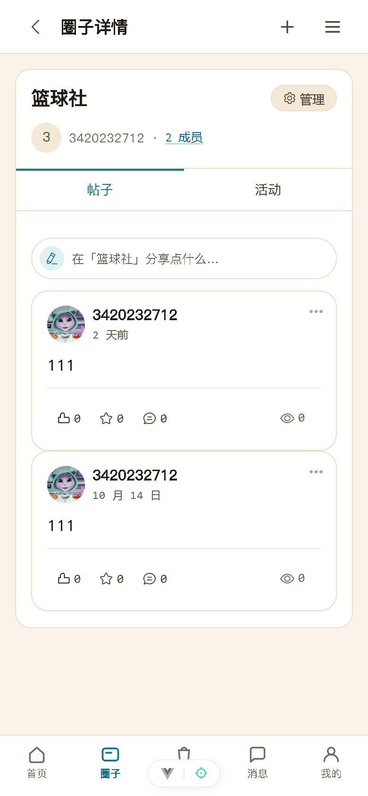   <sub><b>圈子详情</b></sub></td>  
</tr>  
<tr>  
<td width="33%" align="center">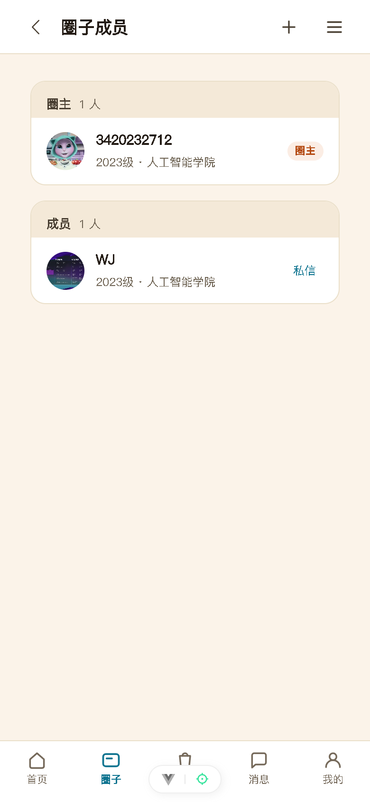   <sub><b>圈子成员</b></sub></td>  
<td width="33%" align="center">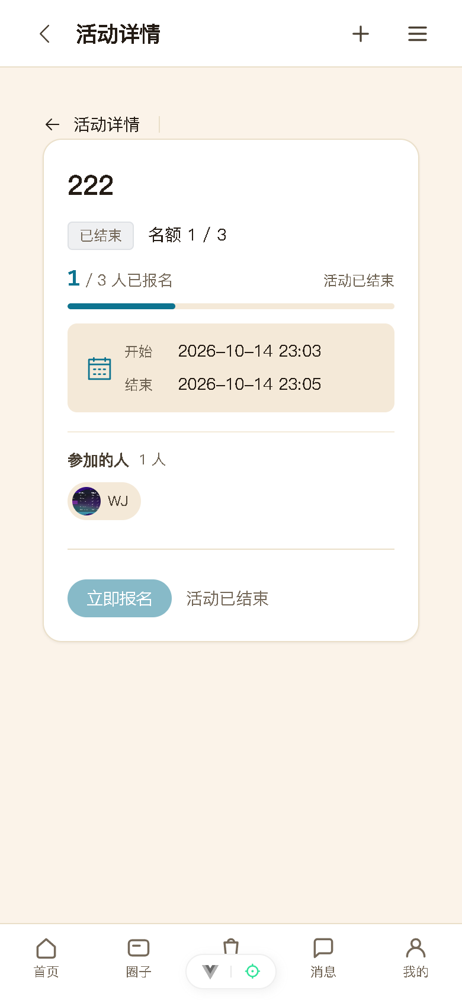   <sub><b>活动详情</b></sub></td>  
<td width="33%" align="center">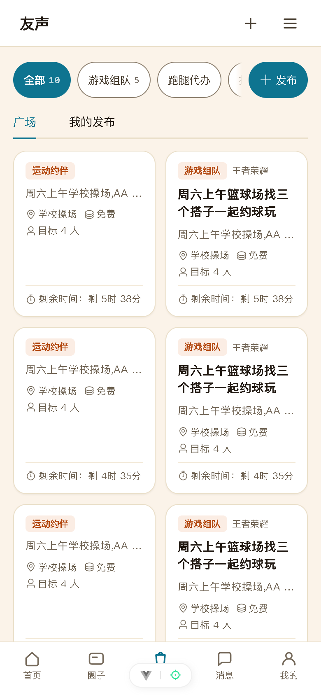   <sub><b>集市广场</b></sub></td>  
</tr>  
<tr>  
<td width="33%" align="center">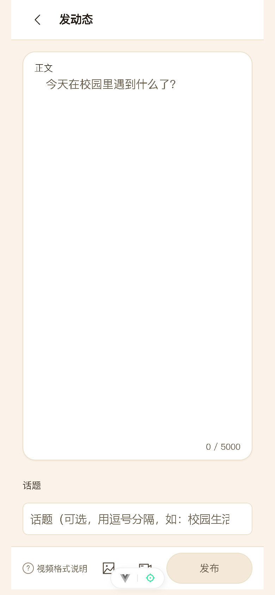   <sub><b>发动态</b></sub></td>  
<td width="33%" align="center">   <sub><b>私信</b></sub></td>  
<td width="33%" align="center">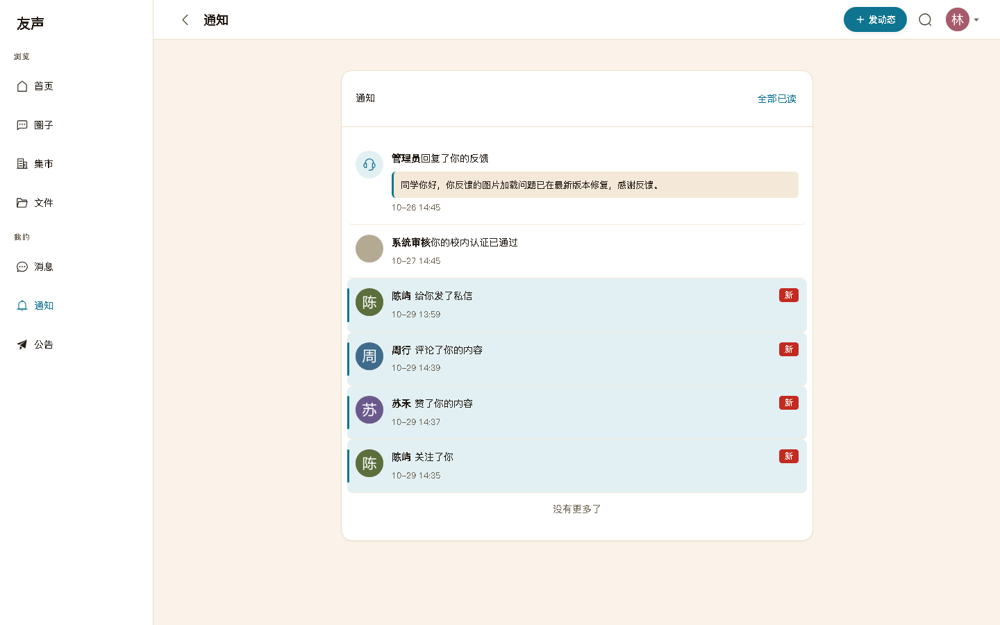   <sub><b>通知</b></sub></td>  
</tr>  
</table>

### 桌面端

桌面不是把手机界面拉宽，而是**重新组织信息层级**：左侧固定导航，中间内容列，右侧信息栏。


<sub>圈子详情桌面端：主列 640px 承载内容，右栏 268px 收纳圈子概况、圈主、圈内规则 —— 这类静态元信息不该占主列的视线落点。</sub>

<table>  
<tr>  
<td width="50%">   <sub><b>首页 · 关注/全部双流</b></sub></td>  
<td width="50%">   <sub><b>集市 · 卡片网格</b></sub></td>  
</tr>  
</table>

---

## 设计稿

每个功能在动手写代码之前，都先出了一版**可交互的 HTML 设计稿**：把布局、间距、状态、边界情况先画出来对着看，确认无误再落到 Vue 组件上。这比直接写代码快，也避免了「写完才发现方向不对」。

设计稿是可直接在浏览器打开的静态 HTML（含手机/桌面双形态对比、状态枚举、落地清单），源文件在 [`docs/design/`](docs/design/)。

### 圈子的两个补完

<table>  
<tr>  
<td width="50%">  
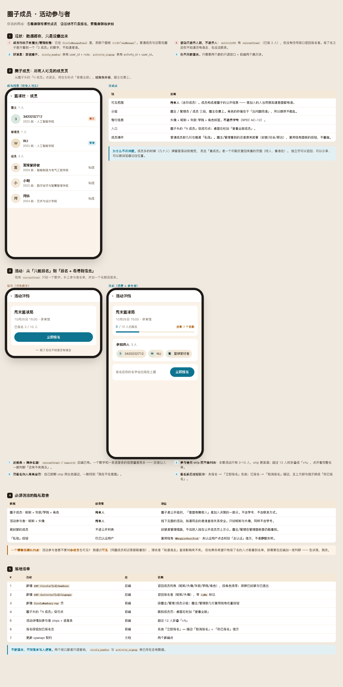  
   <sub><b>圈子成员 · 活动参与者</b>：成员列表从「仅圈主可见」扩展为公开页；活动从「只能报名」补上进度条与参与者名单。<a href="docs/design/preview-members.html">打开原稿 →</a></sub>  
</td>  
<td width="50%">  
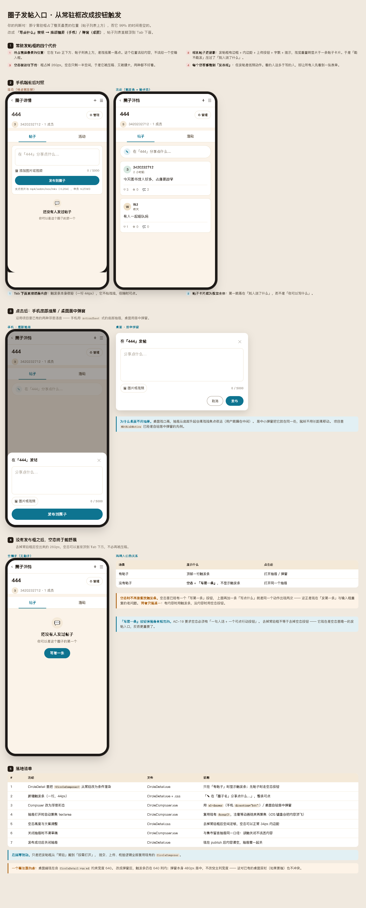  
   <sub><b>圈子发帖改造</b>：常驻发帖框改成一行触发条 + 底部抽屉，把 Tab 下方最贵的视线落点还给帖子列表。<a href="docs/design/preview-circle-composer.html">打开原稿 →</a></sub>  
</td>  
</tr>  
</table>

### 集市

<table>  
<tr>  
<td width="50%">  
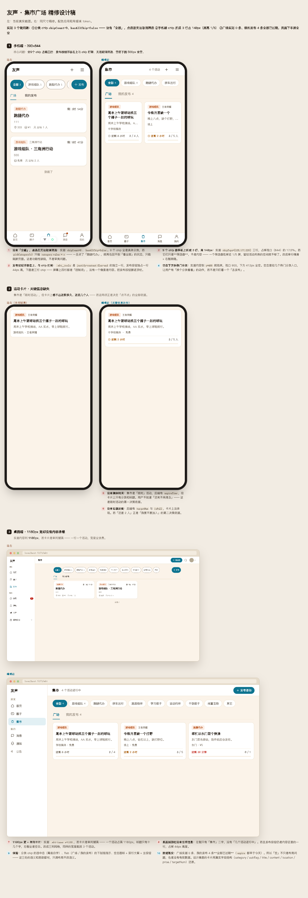  
   <sub><b>集市广场</b><a href="docs/design/preview-mkt.html">原稿 →</a></sub>  
</td>  
<td width="50%">  
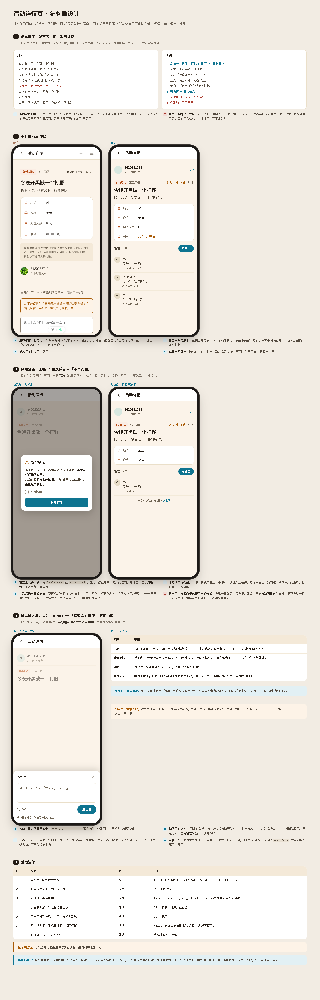  
   <sub><b>集市详情布局</b><a href="docs/design/preview-mkt-detail-layout.html">原稿 →</a></sub>  
</td>  
</tr>  
</table>

### 注册与认证

<table>  
<tr>  
<td width="50%">  
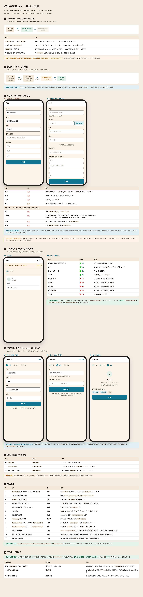  
   <sub><b>注册 + 三步引导</b>：账号信息、校内身份、兴趣标签、关注推荐。<a href="docs/design/preview-register-verify.html">原稿 →</a></sub>  
</td>  
<td width="50%">  
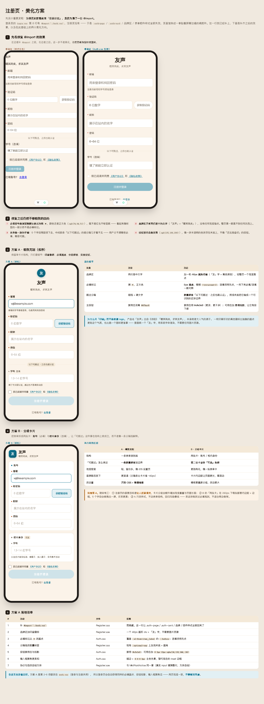  
   <sub><b>注册页打磨</b>：分组卡片，邮箱为必填（含验证码），学号改为可选。<a href="docs/design/preview-register-polish.html">原稿 →</a></sub>  
</td>  
</tr>  
</table>

### 公告

<table>  
<tr>  
<td width="33%">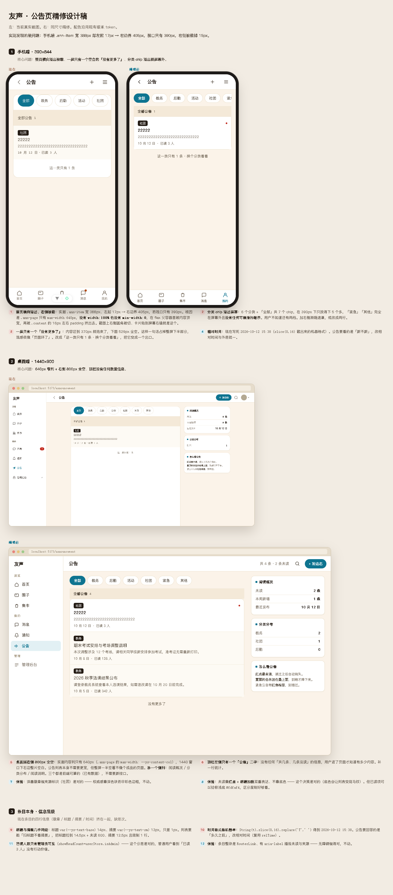   <sub><b>公告列表</b>  
<a href="docs/design/preview-announcement.html">原稿 →</a></sub></td>  
<td width="33%">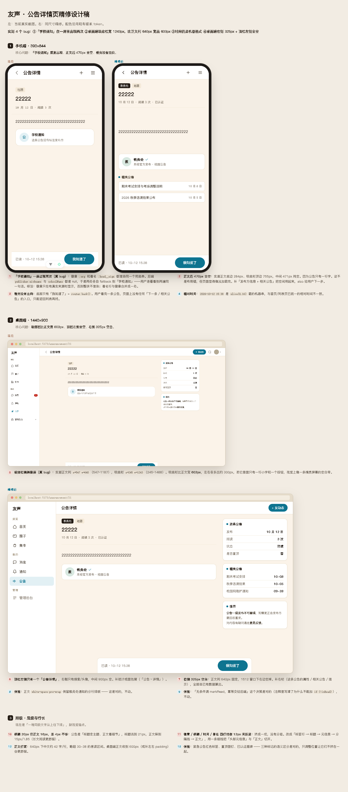   <sub><b>公告详情</b>  
<a href="docs/design/preview-announcement-detail.html">原稿 →</a></sub></td>  
<td width="33%">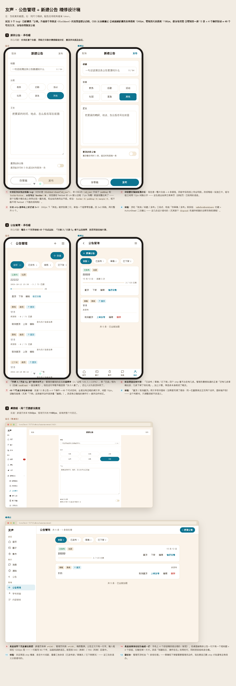   <sub><b>公告管理端</b>  
<a href="docs/design/preview-admin-announcement.html">原稿 →</a></sub></td>  
</tr>  
</table>

<details>

<summary><b>全部 15 份设计稿</b>（点击展开）</summary>

| 设计稿    | 主题         | 原稿                                                   |
| ------ | ---------- | ---------------------------------------------------- |
| 全局改版   | 暖米色设计系统确立  | [HTML](docs/design/preview-redesign.html)            |
| 桌面端布局  | 三栏结构与断点    | [HTML](docs/design/preview-desktop.html)             |
| 圈子详情   | 空态、视频提示、右栏 | [HTML](docs/design/preview-circle-detail.html)       |
| 圈子发帖   | 触发条与抽屉     | [HTML](docs/design/preview-circle-composer.html)     |
| 圈子成员   | 成员页与活动参与者  | [HTML](docs/design/preview-members.html)             |
| 集市广场   | 卡片网格与筛选    | [HTML](docs/design/preview-mkt.html)                 |
| 集市详情   | 字段层级与风险提示  | [HTML](docs/design/preview-mkt-detail.html)          |
| 集市详情布局 | 桌面双栏重排     | [HTML](docs/design/preview-mkt-detail-layout.html)   |
| 集市交互逻辑 | 状态机与边界态    | [HTML](docs/design/preview-mkt-logic.html)           |
| 集市发布   | 表单与投放时长    | [HTML](docs/design/preview-mkt-publish.html)         |
| 注册与认证  | 三步引导全流程    | [HTML](docs/design/preview-register-verify.html)     |
| 注册页打磨  | 分组卡片方案     | [HTML](docs/design/preview-register-polish.html)     |
| 公告列表   | 分类与置顶      | [HTML](docs/design/preview-announcement.html)        |
| 公告详情   | 已读回执与提醒    | [HTML](docs/design/preview-announcement-detail.html) |
| 公告管理端  | 新建、置顶、谁还没看 | [HTML](docs/design/preview-admin-announcement.html)  |

> 预览图渲染脚本：[`scripts/render-design-shots.mjs`](scripts/render-design-shots.mjs)

</details>

---

## 功能模块

| 模块               | 说明                                       | 状态 |
| ---------------- | ---------------------------------------- | -- |
| **M1 账号**        | 邮箱验证码注册、JWT 双 token、refresh 吊销、学号可选、找回密码 | ✅  |
| **M2 关注**        | 关注/取关/好友/黑名单，事务内计数 ±1，游标分页               | ✅  |
| **M3 帖子 + Feed** | 写扩散、游标分页、图文视频、敏感词 DFA、点赞评论、热度分           | ✅  |
| **M4 私信**        | 会话 + 消息、WS 实时推送、已读回执、陌生人额度               | ✅  |
| **M5 通知**        | 点赞/评论/关注事件、WS 推送、未读计数                    | ✅  |
| **M6 圈子**        | 圈主/圈管理/成员三级角色、封禁、任命、成员页                  | ✅  |
| **M7 活动**        | 报名防超卖、名额进度、参与者名单                         | ✅  |
| **M8 集市**        | 二手信息、风险提示、留言、投放时长、举报                     | ✅  |
| **M9 公告**        | 分类、置顶、已读回执、提醒未读                          | ✅  |
| **M10 管理后台**     | 举报处置、内容审核、学号核验、反馈处理、操作日志                 | ✅  |
| **M11 搜索**       | 全文检索（中文 ngram 分词）、话题、用户                  | ✅  |

---

## 技术架构

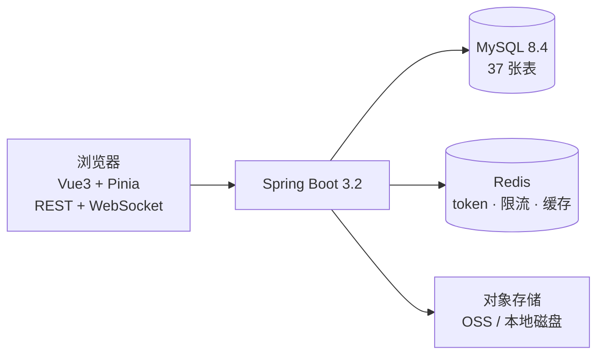

| 层   | 选型                                        | 说明                                               |
| --- | ----------------------------------------- | ------------------------------------------------ |
| 前端  | Vue 3.4 + Vite 5.4 + Pinia + vue-router 4 | 组合式 API，按域拆分 composable                          |
| UI  | Element Plus 2.14（按需引入）                   | 自建暖米色 design tokens 覆盖默认主题                       |
| 后端  | Spring Boot 3.2.5 + MyBatis-Plus 3.5.7    | 注解式 SQL，无 mapper XML                             |
| 数据库 | MySQL 8.4                                 | 37 张表，统一 `id/create_time/update_time/is_deleted` |
| 缓存  | Redis 7                                   | token 指纹、滑动窗口限流、首屏骨架缓存                           |
| 实时  | Spring 原生 WebSocket                       | 双端点（chat / notify），握手 JWT 鉴权                     |
| 鉴权  | JWT 双 token（HS512）                        | access 15min / refresh 7d，jti 指纹防重用              |

---

## 快速开始

### 环境要求

- JDK 17+
- MySQL 8.x（建库 `campus_social_v2`，跑 [`sql/schema.sql`](sql/schema.sql) —— 完整基线，37 张表一次建齐）
- Redis 6+（默认 `127.0.0.1:6379`）
- Node 18+

### 启动

```bash
# 1. 配置（凭据只进 .env，源码一律 ${ENV:} 引用且默认值留空）
cp .env.example .env      # 然后填写真值

# 2. 后端
cd backend && mvn spring-boot:run

# 3. 前端
cd frontend && npm install && npm run dev
```

浏览器打开 <http://localhost:5173>，登录页在 `/login/form`。

关键配置在 `backend/src/main/resources/application.yml`：

| 变量                                             | 说明                  |
| ---------------------------------------------- | ------------------- |
| `MYSQL_HOST` / `MYSQL_USER` / `MYSQL_PASSWORD` | 数据库连接               |
| `REDIS_HOST` / `REDIS_PORT`                    | 缓存连接                |
| `JWT_ACCESS_SECRET` / `JWT_REFRESH_SECRET`     | 至少 64 字节，生产用强随机     |
| `UPLOAD_DIR`                                   | 默认 `./uploads`，相对路径 |
| `CORS_ALLOWED_ORIGINS`                         | 域名白名单，未配置时只放行本机开发端口 |

> **密钥管理约定**：凭据只进 `.env`（已 gitignore），模板 `.env.example` 只列变量名与占位说明。`application-local.yml` 中的凭据段也都是「带空默认」的引用 —— 把默认值填成真实密钥等于又把它写回源码。

### 质量门禁

```bash
python scripts/run-all-gates.py    # 10 条门禁
cd backend && mvn test             # 44 个用例
```

门禁涵盖：单文件 400 行上限、外部 CSS 括号平衡、契约字段一致性、日期格式、学号解析等。pre-push 钩子会自动执行，真逻辑错拦 push，环境类失败（OOM/缺命令）只告警放行。

---

## 项目结构

```
校园社交/
├─ backend/              Spring Boot（单模块 com.campus.social）
│  └─ src/main/java/com/campus/social/
│     ├─ controller/     REST 接口（无业务逻辑）
│     ├─ service/impl    业务 + @Transactional
│     ├─ mapper/         MyBatis-Plus BaseMapper
│     ├─ entity/ dto/ vo/ 数据模型三层
│     ├─ config/         Jwt / Redis / MybatisPlus / WebSocket / WebMvc
│     ├─ interceptor/    AuthInterceptor（HTTP JWT）
│     ├─ websocket/      WsHandler + SessionManager + PushService
│     ├─ task/           敏感词刷新 + 活动状态机
│     └─ util/           JwtUtil + SensitiveWordFilter（DFA）
├─ frontend/             Vue 3
│  └─ src/
│     ├─ api/            按域拆分的接口模块
│     ├─ views/          页面
│     ├─ components/     可复用组件（按域分目录）
│     ├─ composables/    组合式逻辑
│     ├─ stores/         Pinia（user 唯一持 token）
│     ├─ styles/         design-tokens.css（样式真源）
│     └─ utils/          request.js（401 刷新队列）/ ws.js（WS 单例重连）
├─ docs/
│  ├─ design/            设计稿 HTML + 渲染图
│  ├─ screens/           README 用界面截图
│  └─ api/openapi.yaml   API 契约
├─ sql/schema.sql        37 张表完整基线
└─ scripts/              门禁、截图、渲染脚本
```

---

## 文档索引

| 文档                                   | 内容                 |
| ------------------------------------ | ------------------ |
| [PRD](docs/PRD.md)                   | 产品需求与用户故事          |
| [SPEC](docs/SPEC.md)                 | 详细规格与验收标准          |
| [ARCHITECTURE](docs/ARCHITECTURE.md) | 架构决策与成本估算          |
| [API 契约](docs/api/openapi.yaml)      | OpenAPI 3.0，63 条路径 |
| [部署清单](docs/DEPLOY_ECS.md)           | ECS 从零部署步骤         |
| [推广前检查清单](docs/推广前检查清单.md)           | 上线前待办              |
| [ADR](docs/decisions/)               | 架构决策记录             |

---

<div align="center" markdown="1">

**友声** · campus-social

嘤其鸣矣，求其友声

<sub>🌐 [yousheng8.cn](http://yousheng8.cn) · 域名备案中，即将上线</sub>

</div>
