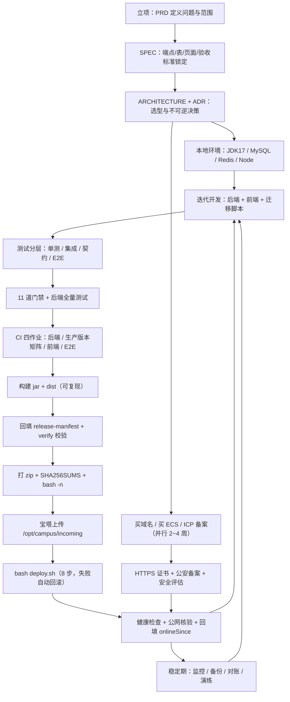
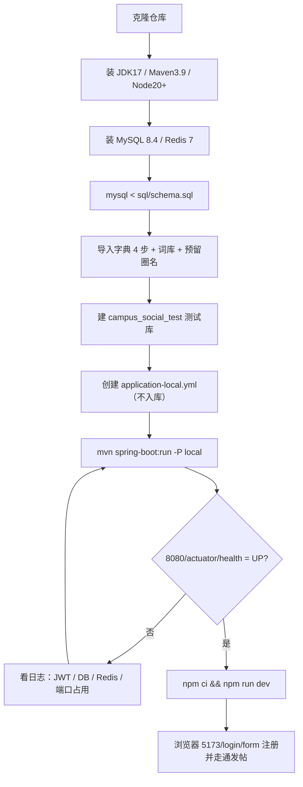
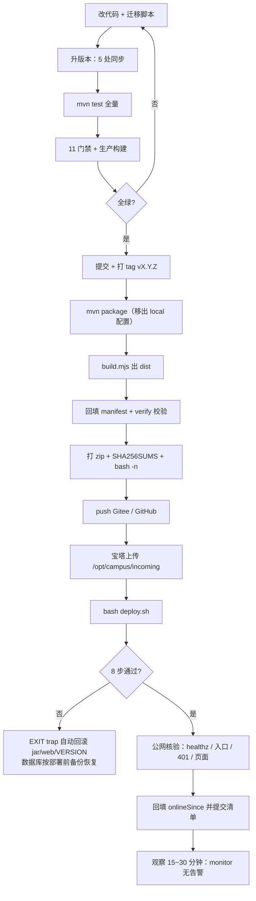
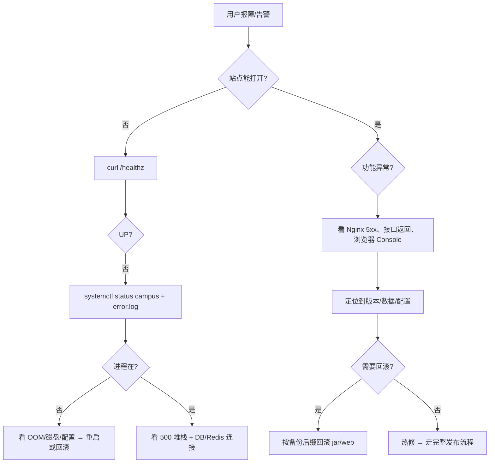
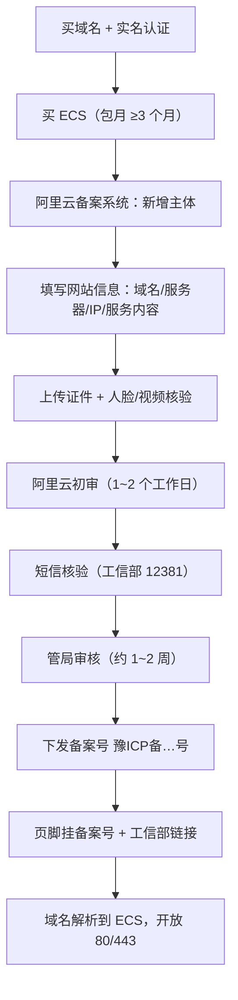
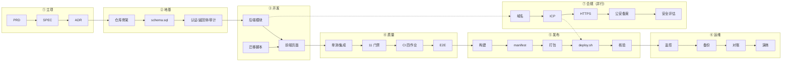
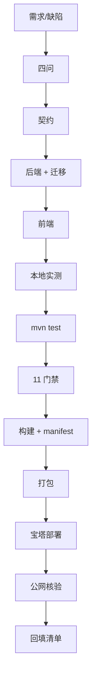
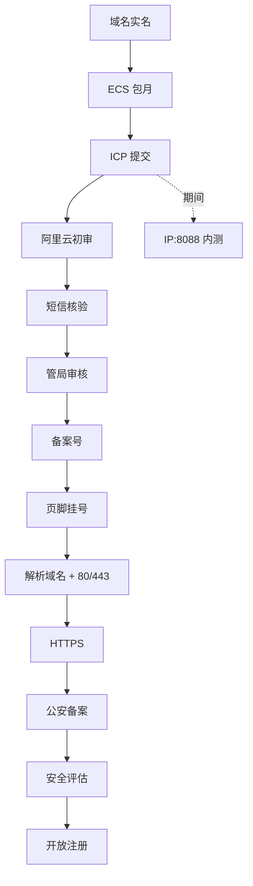

# 友声 · 从 0 到上线全流程手册

> **这是什么**：把「友声」校园社交平台从第一行代码到线上 1.13.12 的全过程，压缩成一份可复用的工程手册。目的是：下一次做同类项目（Spring Boot + Vue + 阿里云单机）时，不必再从零摸索环境、备案、发布与运维。
>
> **生成时间**：2026-11-02（Asia/Shanghai）
> **事实来源**：仓库实测（`git log` 277 次提交、`docs/` 全部文档、`deploy/`、`sql/`、`scripts/`、`.github/workflows/ci.yml`、`release-manifest.json`）+ 项目记忆库 17 个文件 + 用户偏好记忆 10 个文件。
> **口径说明**：文中「线上」指 2026-11-01 20:47 部署的 **1.13.12**（纯前端修复，后端沿用 1.13.11 jar）。凡是历史数字（测试数、包大小、md5）都标注了时间点，不要当作永久值。
> **维护方式**：改完代码/发布后，同步更新 §15.4 版本历史与 `docs/项目最新状态.md`；新增一条踩坑就补进 §12。

---

## 目录

| 章 | 内容 | 什么时候看 |
| --- | --- | --- |
| [0](#0-一页纸总览) | 一页纸总览 + 总流程图 | 第一次读 |
| [1](#1-项目是什么) | 产品范围、角色、规则口径 | 接手/复盘 |
| [2](#2-技术栈与版本锚定) | 版本表与锁定理由 | 搭环境前 |
| [3](#3-仓库结构与文档地图) | 目录、文档、ADR | 找东西 |
| [4](#4-本地开发环境从零搭建) | JDK/Maven/Node/MySQL/Redis、建库、启动 | 新机器 |
| [5](#5-开发流程) | 文档驱动、门禁、CI、提交 | 每次写代码 |
| [6](#6-数据库与迁移) | 39 表、迁移、计数、对账、备份 | 改表/改计数 |
| [7](#7-构建与发布) | 版本、manifest、打包、deploy.sh、回滚 | 每次发版 |
| [8](#8-服务器与运维) | systemd、Nginx、调优、监控、告警 | 上线/排障 |
| [9](#9-域名备案与合规) | 域名、ICP、HTTPS、公安备案、安全评估、邮件、OSS | 新项目上线前 |
| [10](#10-凭据管理) | 零 AK、临时 SSH、绝不入库清单 | 碰密钥时 |
| [11](#11-质量与性能基线) | 测试数字、压测、容量上限、已知技术债 | 评估质量 |
| [12](#12-踩坑与根因手册) | 30 条真实故障的现象/根因/防复发 | 出事时 |
| [13](#13-新项目复用清单) | 六阶段 checklist | 新项目 |
| [14](#14-流程图合集) | Mermaid 全图 | 汇报/答辩 |
| [15](#15-附录) | 命令、端口、环境变量、版本史、术语 | 速查 |

---

## 0. 一页纸总览

### 0.1 项目坐标

| 维度 | 值 |
| --- | --- |
| 产品名 | 友声（校园生活社区） |
| 线上地址 | <https://yousheng8.cn>（HTTP 301 → HTTPS，HTTP/2） |
| 线上版本 | 1.13.12（前端）/ 1.13.11（后端 jar），2026-11-01 20:47 部署 |
| 源码 | 私有仓库，`master` 单分支，Gitee + GitHub 双远端；277 次提交（2026-10-07 → 2026-11-01） |
| 服务器 | 阿里云 ECS 华东1（杭州），`ecs.e-c1m1.large`，2 核 2G，Ubuntu 22.04，ESSD 40G，3Mbps，公网 `120.26.4.66` |
| 备案 | 豫ICP备2026053499号（2026-10-28）；豫公网安备41082302411216号（2026-11-06） |
| 数据库 | MySQL 8.0（生产，Ubuntu 22.04 apt）/ 8.4（开发与 CI），库 `campus_social_v2`，**39 表 / 0 外键** |
| 缓存 | Redis 6.0.16（生产，Ubuntu 22.04 默认；CI 兼容基线为 6），代码按 **Redis 5.0 语义**编写 |
| 存储 | 阿里云 OSS 私有桶 `yousheng-uploads`（华东1），ECS 实例角色零 AK；自定义域 `oss.yousheng8.cn` |
| 邮件 | 阿里云 DirectMail，发信地址 `system@yousheng8.cn`，ECS 实例角色 `mail`，模板 445523 |
| 部署通道 | 宝塔面板上传 zip + 终端执行 `deploy.sh`（ECS 不开放 SSH 长期权限） |
| 规模指标 | 接口 90 路径 / 100 操作；后端 50 个测试类 / 257 用例；前端 11 道门禁；首屏 JS 334,633 B（gzip ≈175 KB） |

### 0.2 六阶段流水线（文字版）

```
① 立项与需求      ② 设计与地基        ③ 本地可跑
PRD / SPEC   →   ARCHITECTURE / ADR  →  环境 / 建库 / 起服
                                          ↓
⑥ 稳定期        ⑤ 上线与验证        ④ 可测可发布
监控 / 备份  ←   deploy.sh / 核验  ←  门禁 / CI / manifest / 打包
备份演练 / 对账                       ↑
                                     域名 + ECS + ICP 备案（与 ③④ 并行）
```

### 0.3 总流程图



> 关键顺序约束：**备案必须在「域名解析到大陆 ECS + 开放 80/443」之前完成**；否则会被拦截。备案周期长，应与开发并行，不要等代码写完再开始。

---

## 1. 项目是什么

### 1.1 一句话

面向本校学生的内容社区：发帖/信息流、圈子、私信与群聊、活动、集市、通知、公告、搜索、管理后台，共 **11 个功能模块**，单机可上线运营。

### 1.2 功能模块

| # | 模块 | 关键能力 |
| --- | --- | --- |
| 1 | 账号与校内身份 | 邮箱验证码登录即注册、密码登录、双令牌、校园信息（可选）、注销 |
| 2 | 关注关系 | 关注/取关、粉丝/关注列表、关注流 |
| 3 | 帖子与信息流 | 发帖（图文/视频）、评论、点赞、收藏、分享、话题、热榜、写扩散 + 游标分页 |
| 4 | 私信与群聊 | 双人会话、未读数、撤回、群聊、群成员/群主移交 |
| 5 | 通知 | 点赞/评论/@/系统/举报回执/封禁/禁言等类型，未读汇总 |
| 6 | 圈子 | 建圈、加入/退出、圈管理、圈内帖子、封禁/解散 |
| 7 | 活动 | 发布、报名、容量控制、取消、按圈归属 |
| 8 | 集市 | 二手交易发布、上下架、在投配额、留言 |
| 9 | 公告 | 管理员发布、已读状态 |
| 10 | 管理后台 | 内容审核、举报处置、用户处置（封禁/禁言）、圈子管理、字典/词库、审计日志 |
| 11 | 搜索 | 帖子/用户/圈子/集市关键词搜索（MySQL 全文索引） |

### 1.3 角色

- **游客**：只读公开内容（首页、圈子、集市、搜索、他人主页、帖子详情与分享页）。
- **注册用户**：发帖/评论/点赞/收藏/加入圈子/回复已有会话。
- **高门槛动作**（注册满 24 小时 + 信誉分 ≥60）：陌生人搭话、建圈、建群/邀请、圈子活动报名、集市发布。
- **圈主/群主**：圈/群内管理，注销时自动移交或解散。
- **管理员**（`user.role=1`）：审核、举报处置、用户处置、字典维护。

### 1.4 规则口径（写进产品与合规文档的版本）

| 规则 | 口径 |
| --- | --- |
| 注册 | 邮箱验证码即注册；昵称自动生成「用户+6 位随机数」；不强制设密码 |
| 发帖配额 | 按信誉分档位每日 5 / 10 / 15 条 |
| 集市配额 | 同时在投 1 条 |
| 举报处置 | `ban` / `mute` / `takedown` / `reject` / `ignore`，乐观更新 `WHERE status=0` 防重复处置 |
| 禁言 | 可登录浏览，只拦发帖（含编辑）/评论/私信/群消息；集市发布与文件上传不拦 |
| 注销 | 验证码确认 → 匿名化 + 释放邮箱/学号唯一键 + 吊销令牌 + 级联退出群/圈/活动 |
| 通知类型 | 18 举报回执、19 封禁、20 下架、21 解封、23 圈子解散、24 禁言、25 解除禁言 |
| 游客边界 | 消息/我的/通知/公告/文件等登录项**不渲染**，不做「点了才拦」 |

### 1.5 明确不做（避免范围蔓延）

支付、短信验证码、直播、独立短视频频道、推荐算法、微服务/K8s、多租户、原生 App。理由与替代方案见 `docs/SPEC.md` §3、`docs/PRD.md` §9。

---

## 2. 技术栈与版本锚定

### 2.1 版本表

**后端**

| 组件 | 版本 | 锁定理由 |
| --- | --- | --- |
| Java | 17 | ECS 装 `openjdk-17-jre-headless`；Spring Boot 3 最低 17 |
| Spring Boot | 3.2.5 | 单体 + 内嵌 Tomcat + Actuator；升级需全量回归，非必要不动 |
| MyBatis-Plus | 3.5.7 | 逻辑删除、分页、自动填充；`@TableLogic` 全局生效 |
| MySQL | 生产 8.0 / 开发 8.4 | Ubuntu 22.04 apt 默认 8.0；CI 同时跑 8.0 与 8.4 两套 |
| Redis | 生产 6.0.16 / 开发 5.0~7 均可 | 代码按 5.0 语义写，不用 6.2+ 才有的命令 |

> **版本口径提醒**：`docs/上线复盘-2026-10-09.md` 记录首次上线时服务器为 MySQL 8.4.11（宝塔安装），而 `deploy/` 手册与 CI 兼容矩阵按 MySQL 8.0 + Redis 6 描述「生产基线」。两者可能来自不同时点的重装/升级。**接手时先跑 `SELECT VERSION();` 与 `redis-server --version` 现场核实**，不要只信文档；ADR-005 写的「MySQL 8.4 LTS + Redis 7」是设计目标，不是现场事实。
| JWT | jjwt 0.12.5 | HS512；access 15 分钟、refresh 3 天（记住我 7 天） |
| 实时通信 | 原生 WebSocket | 单机内存广播，不引 MQ；临界点 5000 连接或第 2 实例（ADR-004） |
| 文档 | springdoc | 默认关闭，`SWAGGER_ENABLED=true` 才开 |

**前端**

| 组件 | 版本 | 说明 |
| --- | --- | --- |
| Vue | 3.4 | 组合式 API |
| Vite | 5.4 | `componentIdGenerator: 'filepath'` 保证构建可复现 |
| Pinia | 2.2 | 状态管理 |
| Element Plus | 2.14.5 | 按需引入（unplugin-vue-components + AutoImport），**不要**加 manualChunks 整包 |
| 其它 | axios、dayjs、pdfjs-dist、qrcode、ali-oss | 文件预览、分享二维码、OSS 直传 |

**基建与工具**

| 类别 | 选型 |
| --- | --- |
| 服务器 | 阿里云 ECS 2 核 2G / Ubuntu 22.04 / 3Mbps |
| Web | Nginx（80/443，同源部署，反代 `/api`、`/ws`、`/upload`、`/uploads`） |
| 进程 | systemd（`campus.service`，`Restart=on-failure`） |
| TLS | Let's Encrypt（certbot 自动续期，90 天） |
| 面板 | 宝塔（文件上传、终端、MySQL/Nginx 管理） |
| 对象存储 | OSS 私有桶 + 实例 RAM 角色 |
| 邮件 | 阿里云 DirectMail + 实例 RAM 角色 |
| 监控 | 阿里云云监控（主机）+ `campus-monitor`（应用层）+ `campus-metrics`（指标采样） |
| CI | GitHub Actions（4 作业） |
| E2E | Playwright（`e2e/` 独立 npm 包） |
| 门禁 | Python 脚本 11 道（`scripts/run-all-gates.py`） |
| 分支 | `master` 单分支 + 语义化版本 tag |

### 2.2 为什么锁版本

1. **防止幻觉 API**：`docs/SPEC.md` §4.2 与 `docs/ARCHITECTURE.md` §6 是版本锚定表，写代码前先查表；不确定的 API 一律以文档为准。
2. **本地与生产不一致会制造假故障**：开发机 Redis 5.0、生产 6.0.16，代码必须按 5.0 语义写（不用 `GETDEL` 等），否则本地跑不通、线上才发现。
3. **构建可复现**：前端 `componentIdGenerator: 'filepath'` + 后端 `project.build.outputTimestamp` + `.gitattributes` 统一 LF，保证同一提交两次构建产物哈希一致（1.13.3 实测两次 jar md5 相同）。

---

## 3. 仓库结构与文档地图

### 3.1 目录

```
F:\校园社交\
├─ backend/                     Spring Boot 单体（com.campus.social）
│  ├─ src/main/java/…           controller · service/impl · mapper · entity/dto/vo
│  │                            config · interceptor · websocket · task · util
│  ├─ src/main/resources/       application.yml（占位符）· mapper/*.xml
│  │                            application-local.yml（**本地私密，已 gitignore**）
│  └─ src/test/java/…           50 个测试类 / 257 用例
├─ frontend/                    Vue 3 + Vite
│  ├─ src/                      api · views · components · composables · stores · utils
│  ├─ scripts/                  门禁脚本、build.mjs、check-firstscreen-size.mjs
│  └─ vite.config.js            dev 代理 /api、/uploads、/ws
├─ e2e/                         Playwright 冒烟（独立 npm 包，进 CI）
├─ sql/                         schema.sql（39 表基线）+ 迁移 + 词库 + 演示数据
├─ scripts/                     run-all-gates.py · verify-release-manifest.py
│                               verify-openapi/contract/datetime/studentno/reason-enum
│                               smoke.py · package-source.py · git-hooks
├─ deploy/                      生产配置与运维脚本（可整体搬到新项目）
│  ├─ nginx/production.conf     线上 Nginx 抓取镜像（三 server 块）
│  ├─ ops/                      backup.sh · backup-watchdog.sh · restore-check.sh
│  │                            check-consistency.sh · app_monitor.py · metrics-snapshot.sh
│  ├─ systemd/                  campus-backup / watchdog / monitor / metrics 的 service+timer
│  └─ oss/                      生命周期规则模板
├─ docs/                        PRD · SPEC · ARCHITECTURE · DEPLOY_ECS · decisions/ · api/ · design/
├─ .github/workflows/ci.yml     4 作业
├─ docker-compose.yml           本地一键起（MySQL + Redis + 后端 + 前端）
├─ release-manifest.json        发布清单（版本、来源提交、哈希、迁移列表）
└─ .e2e-env/                    **gitignore**：部署包、截图、压测与一次性脚本
```

### 3.2 文档地图（谁回答什么问题）

| 文档 | 回答的问题 | 何时读 |
| --- | --- | --- |
| `docs/PRD.md` | 为谁解决什么问题、RICE 排序、不做什么 | 立项/需求变更 |
| `docs/SPEC.md` | 端点、表、页面、验收标准（锁定值） | 写代码前 |
| `docs/ARCHITECTURE.md` | 选型对比、分层约束、性能目标、版本锚定 | 架构评审 |
| `docs/decisions/ADR-001~010` | 不可逆决策的取舍与后果 | 想推翻某个设计时 |
| `docs/DEPLOY_ECS.md` | ECS 从零部署、迭代、回滚、调优、备份、监控 | 上线/运维 |
| `docs/RELEASE_CHECKLIST.md` | 功能设计四问 + 发布门禁 + 部署回滚顺序 | 每次发版 |
| `docs/项目最新状态.md` | 当前线上版本、质量数字、已知风险、下一步 | 每次接手 |
| `docs/测试总结-2026-10-25.md` | 四层防线与缺陷分布 | 评估测试有效性 |
| `docs/上线复盘-2026-10-09.md` | 首次上线的 17 个坑与方法论 | 上线前必读 |
| `docs/本地起服与发信排障复盘-2026-10-17.md` | 本地起服 + DirectMail 排障 | 本地跑不起来 |
| `docs/ops/performance-metrics.md` | 指标端点、采样、慢查询开启步骤 | 性能排查 |
| `docs/api/openapi.yaml` | 90 路径 / 100 操作的契约 | 前后端联调 |
| `docs/design/UIUX.md` + tokens | 设计令牌与三条设计红线 | 改 UI |

### 3.3 ADR 索引（不可逆决策）

| ADR | 决策 |
| --- | --- |
| ADR-001 | 在现有工程上增量改造，不推倒重写 |
| ADR-002 | 云服务器单机直装（JDK17 + Nginx + MySQL + Redis） |
| ADR-003 | 图标锁定 `@element-plus/icons-vue 2.3.2`，禁止第二套图标库 |
| ADR-004 | WebSocket 单机内存广播，不引 MQ；临界点 5000 连接或第 2 实例 |
| ADR-005 | 生产锚定 MySQL 8.4 LTS + Redis 7，代码按 Redis 5.0 语义写（**实际生产版本见 §2.1 的口径提醒**） |
| ADR-006 | MVP 验证码走邮箱（短信延后） |
| ADR-007 | MVP 不接支付 |
| ADR-008 | 对外 API 统一 `/api/v1` 前缀（Nginx 做版本路由） |
| ADR-009 | 设计令牌以 `docs/design/design-tokens.css` 为唯一准绳 |
| ADR-010 | **不启用物理外键（方案 B）**；完整性由应用层 + 迁移保证，生产 0 外键 |

---

## 4. 本地开发环境从零搭建

### 4.1 目标环境

| 组件 | 版本 | 备注 |
| --- | --- | --- |
| 操作系统 | Windows 10/11 | 也可 macOS/Linux，命令自行替换 |
| JDK | 17 | Temurin 或 Oracle 均可 |
| Maven | 3.9 | 用 `mvn -v` 确认 Java 17 |
| Node | 20+（开发机 24） | CI 用 20；`npm ci` 依赖 lockfile |
| MySQL | 8.4（开发）/ 8.0（生产） | 字符集 `utf8mb4` / `utf8mb4_unicode_ci` |
| Redis | 7 推荐（本项目开发机历史为 5.0） | 代码按 5.0 语义写 |
| Git | 任意较新版本 | 本机推送需按 §10.4 处理 CA |

### 4.2 建库与导入顺序（严格照做）

```bash
# 1) 建库 + 全部表（schema.sql 自带 CREATE DATABASE / USE）
mysql -uroot -p < sql/schema.sql

# 2) 字典：学院/年级（7 院系 / 4 年级）
mysql -uroot -p campus_social_v2 < sql/fix_dict_2026-10-10.sql

# 3) 专业字典（62 条）
mysql -uroot -p campus_social_v2 < sql/migration_f12_seed_school_major.sql

# 4) 兴趣标签（60 条）
mysql -uroot -p campus_social_v2 < sql/fix_tags_2026-10-10.sql

# 5) 敏感词（154 条）—— 空表 = 自动审核完全失效
mysql -uroot -p campus_social_v2 < sql/migration_sensitive_words.sql

# 6) 预留官方圈名（38 条）—— 空表 = 任何人都能建「XX学院教务处」
mysql -uroot -p campus_social_v2 < sql/migration_reserved_circle_names.sql

# 7) 可选：演示数据（生产绝不执行！含公开口令 admin@campus.test/admin123）
mysql -uroot -p campus_social_v2 < sql/seed_data.sql
```

导入后自检：

```sql
SELECT COUNT(*) FROM sensitive_word;          -- 应为 154
SELECT COUNT(*) FROM reserved_circle_name;    -- 应为 38
SELECT COUNT(*) FROM information_schema.tables
 WHERE table_schema='campus_social_v2';       -- 应为 39
```

### 4.3 配置文件：两套，永不混用

| 文件 | 是否入库 | 用途 |
| --- | --- | --- |
| `backend/src/main/resources/application.yml` | 入库 | 只放 `${ENV:默认值}` 占位，不含真实密钥 |
| `backend/src/main/resources/application-local.yml` | **gitignore** | 本地连接串、本地 JWT、本地 AK（若需）——**绝不提交** |
| `/opt/campus/.env`（生产） | 不入库 | 生产环境变量，root:root 0600 |
| `/etc/systemd/system/campus.service` | 不入库（仓库只有模板） | 生产环境变量也可写在这里 |

本地最小配置（`application-local.yml`）：

```yaml
spring:
  datasource:
    url: jdbc:mysql://127.0.0.1:3306/campus_social_v2?useUnicode=true&characterEncoding=UTF-8&useSSL=false&serverTimezone=Asia/Shanghai&allowPublicKeyRetrieval=true&rewriteBatchedStatements=true
    username: root
    password: <本机密码>
  data:
    redis:
      host: 127.0.0.1
      port: 6379
mybatis-plus:
  configuration:
    log-impl: org.apache.ibatis.logging.stdout.StdOutImpl
jwt:
  access-secret: <≥64 字节>
  refresh-secret: <另一段 ≥64 字节>
app:
  campus:
    message-gateway: dev     # 验证码打印到控制台，不发真邮件
```

**JWT 生成**：`openssl rand -hex 48`（96 个十六进制字符，不含 `/` `+` `=`，适合塞进 sed/yaml）。不足 64 字节启动即失败，这是**预期的 fail-fast**，不是 bug。

### 4.4 启动顺序

```bash
# 1) 后端（端口 8080）
cd backend
mvn spring-boot:run -Dspring-boot.run.profiles=local

# 2) 前端（端口 5173）
cd frontend
npm ci
npm run dev

# 3) 浏览器
# http://localhost:5173/login/form
```

Vite dev 代理（`frontend/vite.config.js`）：

| 前缀 | 目标 | 说明 |
| --- | --- | --- |
| `/api` | `http://localhost:8080`（去前缀） | 避免 CORS |
| `/uploads` | `http://localhost:8080` | 本地盘的图片 |
| `/ws` | `ws://localhost:8080`（`ws:true`） | WebSocket 升级 |

### 4.5 测试库隔离（重要）

集成测试走 `local + test` 双 profile，**不写开发库**：

```bash
sed 's/campus_social_v2/campus_social_test/g' sql/schema.sql | mysql -uroot -p
# 测试库 campus_social_test；Redis 固定用 15 号库
```

### 4.6 端口与地址表

| 服务 | 本地 | 生产 |
| --- | --- | --- |
| 前端 dev | 5173 | 443（Nginx 静态） |
| 后端 | 8080 | 8080（仅监听回环，Nginx 反代） |
| MySQL | 3306 | 3306（仅 127.0.0.1） |
| Redis | 6379 | 6379（仅 127.0.0.1） |
| Nginx | — | 80（301）/ 443（TLS） |
| 健康检查 | `localhost:8080/actuator/health` | `https://yousheng8.cn/healthz` |
| 指标 | `localhost:8080/actuator/prometheus` | **不对外**（只从 ECS 本机访问） |

### 4.7 本地常见故障

| 现象 | 根因 | 解法 |
| --- | --- | --- |
| 启动报 JWT 密钥不足 | 环境变量或 local 配置没加载 | 确认 `-Dspring-boot.run.profiles=local`；密钥 ≥64 字节 |
| 验证码收不到 | `message-gateway` 不是 `dev` | 改 `dev`，看后端控制台 |
| 图片 404 | 本地无 OSS，上传走本地盘 | 确认 `UPLOAD_DIR`；不要填 OSS AK（开发机连不上 OSS） |
| Redis 命令报 unknown command | 开发机 Redis 5.0 缺 6.x 命令 | 代码不用 `GETDEL` 等；或升级本地 Redis 7 |
| `npm run build` 产物越积越多 | 本机 safe-delete 守卫按累计删除数拦截 | 必须用 `node scripts/build.mjs`（两阶段 rename 清空），不要直接 `vite build` |
| `mvn test` 连不上库 | 测试库没建 | 按 §4.5 建 `campus_social_test`，Redis 15 号库 |
| PowerShell 里 `mysqldump > file` 报错 | PS 的 `>` 是重定向语法 | 改用 cmd，或改用 `Out-File -Encoding utf8` |
| 前端 5173 打开 403 / CORS | 后端 CORS 白名单只含 5173/5174 | 用 5173；或把源站加进 `CORS_ALLOWED_ORIGINS` |

### 4.8 本地起服流程图



---

## 5. 开发流程

### 5.1 文档驱动顺序

```
PRD（为什么做） → SPEC（做成什么样） → ARCHITECTURE/ADR（怎么实现、哪些不可逆）
   → 编码 → 测试 → 门禁 → 提交/CI → 构建 → 发布
```

规则：
- **契约先行**：接口改动先改 `docs/api/openapi.yaml`，再写 Java；`verify-openapi.py` / `verify-contract.py` 会检查 `$ref` 悬空与 VO 字段一致性。
- **决策留痕**：不可逆选择写 ADR（新增一篇，不改旧篇）；被推翻的决策在 ADR 里标注 Superseded。
- **一次只派一件事**：一个任务里同时要求「改契约 + 写实现」，实现会把契约挤掉（2026-10-09 真实发生）。

### 5.2 分支、提交与版本

| 项 | 做法 |
| --- | --- |
| 分支 | `master` 单分支；无长期 feature 分支 |
| 提交 | 一个主题一个提交；提交信息写「为什么」不写「改了什么」 |
| 版本 | 语义化 `1.13.x`：大改版.新功能.修复；同一天多个修复合并为一个版本 |
| 标签 | 每次发布打 `vX.Y.Z`，指向源码提交；manifest 记录 tag→commit 映射 |
| 双远端 | Gitee（origin）+ GitHub；推送命令见 §10.4 |

### 5.3 编码硬规则（P0，违反即打回）

1. **单文件 400 行上限**（前端 SFC/composable 同样），当前 16 个类在 303–452 行之间（`docs/项目最新状态.md` §9 的枚举），全部低于 400 行上限。
2. 分层单向依赖：`controller → service → mapper`；controller 不写业务，mapper 不写业务。
3. 逻辑删除统一 `is_deleted`（MyBatis-Plus 全局生效）；查询默认过滤。
4. 索引命名 `uk_`（唯一）/ `idx_`（普通）；多列索引顺序按「等值 → 范围 → 排序」。
5. 日期字段出参一律带 `date-time` 格式（`verify-datetime-format.py` 门禁）。
6. 举报理由枚举只有一个出处（`verify-reason-enum.py` 检查契约与代码一致）。
7. 学号解析必须与 5 个真实样本一致（`verify-studentno-parse.py`）。
8. 设计令牌只用 `design-tokens.css` 中的变量，不写裸色值（三条设计红线可自动检查）。
9. 事务内不发通知/推送：推送在 `TransactionSynchronization.afterCommit` 之后（防止回滚后误发）。
10. 关系删除与计数调整必须走统一入口（`MembershipCleanupSupport`），按**实际影响行数**决定是否减计数。

### 5.4 功能设计四问（每次新增/修改涉及用户、关系、状态、计数时）

1. **注销/封禁/解散时这张表怎么处理？** 清理 / 移交 / 下线不删 / 保留留痕，四选一；新表必须登记到 `UserReferenceInventoryTest` 白名单。
2. **哪些冗余计数要变？** 成员数、报名数、关注/粉丝、加圈数、未读数。
3. **哪些通知要发/不发？** 接收人已注销不写通知；批量通知要去重。
4. **哪些公开读接口要隐藏？** 父实体封禁/解散、操作者注销、成员被封禁时，详情/列表/报名/成员列表各返回什么。

> 这四问就是 2026-11-01 那轮「注销残留 / 计数漂移 / 状态守卫」问题的收敛产物。不写测试就不算回答。

### 5.5 测试分层

| 层 | 内容 | 现状 |
| --- | --- | --- |
| 单元/集成 | `@SpringBootTest` + 真实 MySQL/Redis（`local+test`） | 50 类 / 257 用例 |
| 契约 | OpenAPI 可解析、`$ref` 零悬空、VO 字段一致 | 1 道门禁 |
| 前端静态门禁 | SFC 编译、模板引用、导出契约、未定义标识符、样式、Token 纪律 | 6 道 |
| E2E | Playwright：登录→发帖→评论、举报下架、禁言、注销 | 4 用例 / 6 链路 |
| 压测 | 隔离库 + 100 用户 + 并发/容量脚本 | 13 项并发正确性；1300+ RPS |
| 部署后冒烟 | `/healthz`、入口哈希、`/api/user/me` 401、页面走查 | 每次发布 |

### 5.6 11 道门禁

```bash
python scripts/run-all-gates.py
```

| # | 门禁 | 检查什么 |
| --- | --- | --- |
| 1 | `check-sfc.mjs` | SFC 编译器零提醒 |
| 2 | `check-template-refs.mjs` | 模板里引用的标识符都存在 |
| 3 | `check-external-css.mjs` | 外置样式文件存在、括号平衡 |
| 4 | `check-composable-exports.mjs` | composable 解构契约 |
| 5 | `check-undefined-identifiers.mjs` | 漏 import / 名字写错 |
| 6 | `verify-frontend.py` | P0 规则 + 设计 Token 纪律 |
| 7 | `verify-openapi.py` | 契约可解析、`$ref` 零悬空 |
| 8 | `verify-contract.py` | 契约与 Java VO 字段一致 |
| 9 | `verify-datetime-format.py` | 日期字段带 `date-time` |
| 10 | `verify-studentno-parse.py` | 学号解析与 5 个真实样本一致 |
| 11 | `verify-reason-enum.py` | 举报理由枚举一致且唯一出处 |

执行器设计要点（`scripts/run-all-gates.py`）：
- **不用 `a && b && c`**：第一条失败会中断，后面的门禁根本没跑，输出却像「只有一处问题」。
- 逐条跑完再汇总，每条独立超时 600 秒。
- `--self-test` 注入一真一假两条假门禁，验证「执行器能如实报告失败」——只证明执行器不假绿，不证明各门禁本身有效。

### 5.7 CI 四作业（`.github/workflows/ci.yml`）

| 作业 | 环境 | 干什么 |
| --- | --- | --- |
| `backend` | MySQL 8.4 + Redis 7 service containers | 导入测试库 → 编译 → 全量测试；失败时把 surefire 摘要写成 `::error::` annotation |
| `backend-prod-versions` | MySQL **8.0** + Redis **6** | 生产版本兼容矩阵，防止代码只在新版本通过 |
| `frontend` | Node 20 | `npm ci` → 11 门禁 → 构建 → 首屏 JS gzip < 300 KB 护栏 |
| `e2e` | MySQL 8.4 + Redis 7 + jar + Vite + Chromium | Playwright 跑 6 条主链路；失败上传日志与报告 |

CI 里的两个真实坑：
- MySQL service 的 `options` **只能写 docker 参数**；写 `--character-set-server=utf8mb4` 会让容器启动失败（GitHub 把 options 拼在镜像名之前）。
- 集成测试连真实库，所以必须用 `sed` 把 `schema.sql` 的库名替换为 `campus_social_test` 再导入。

### 5.8 开发流程图


---

## 6. 数据库与迁移

### 6.1 基线

| 项 | 值 |
| --- | --- |
| 表数 | **39**（`sql/schema.sql` 数出 39 个 `CREATE TABLE`） |
| 外键 | **0**（ADR-010 方案 B） |
| 字符集 | `utf8mb4` / `utf8mb4_unicode_ci` |
| 逻辑删除 | `is_deleted`（0/1），MyBatis-Plus 全局 |
| 主键 | `bigint` 自增 |
| 时间 | `create_time` / `update_time`，`Asia/Shanghai` |
| 关键索引 | `user.uk_username`、`post.ft_content`（全文）、`like.uk_like`、`chat_conversation.uk_conv`、`group_member.uk_gm`、`file_asset.idx_status_id`、`school_major.idx_dept` |

> 表数有三个历史口径：37（报告口径，10-25 快照）/ 39（schema.sql 与生产）/ 41（更早的恢复演练）。引用前先说明是哪个来源，别混用。

### 6.2 迁移规范

1. 文件名 `migration_YYYY-MM-DD_主题.sql`，放 `sql/`。
2. **必须幂等**：`CREATE TABLE IF NOT EXISTS`、`ALTER ... ADD COLUMN IF NOT EXISTS`（MySQL 8 用存储过程包一层）或先用 `information_schema` 判断；数据修复用 `INSERT IGNORE` / `UPDATE ... WHERE`。
3. 本地连续执行**两次**无报错，再进部署包。
4. 顺序：历史结构/数据修复 → 计数重算 → 一致性校验（见 §6.4）。
5. 上线前必须备份（`deploy.sh` 第 3 步强制）。
6. 回滚策略：**不做反向 DDL**，用新迁移修补；数据库整体回滚只能靠部署前备份。

### 6.3 计数与对账

冗余计数 6 类：`group.member_count`、`activity.current_count`、`user.joined_circle_count`、`chat_conversation.unread_a/b`、`post.like_count/comment_count`、`circle.member_count`。

写路径规则：
- 删除/插入关系必须走 `MembershipCleanupSupport`，先执行 DELETE/INSERT，**看影响行数**，只有真的删到行才减计数。
- 计数减法用 `GREATEST(0, x - 1)` 兜底，避免负数。
- 并发容量（报名、群人数）用 `SELECT ... FOR UPDATE` 锁父行 + 当前读计数，或带容量条件的原子 UPDATE。

`ReconcileJob`：
- 每天 **03:00** 全量对账：先记录 4 类漂移并写 `campus.data.drift` 指标，再重算用户/加圈/评论/热度/圈/群/活动/未读。
- 每 **10 分钟**只重算最近 7 天帖子的热度分（全表重算代价大且无意义）。
- 对账排除 `status=2`（已注销）账号。

### 6.4 一致性闸门（1.13.11 起）

`sql/consistency_check.sql` 返回**一行 `violations`**，覆盖：

- 已注销账号残留：群成员、圈成员、活动报名、关注关系、群主、圈主、创建的活动、在投集市。
- 四类冗余计数漂移：群人数、报名数、加圈数、私信未读。
- 只读、可重复执行。

部署顺序（`deploy.sh` 第 6 步）：

```
七段迁移
  → migration_2026-11-01_reconcile_counters.sql（按 ReconcileJob 同口径先重算）
  → check-consistency.sh（violations != 0 立即 die，应用文件回滚）
  → systemctl start campus
```

**顺序不能反**：先重算是为了避免历史漂移把闸门卡死；先校验会让旧数据挡住新版本。

### 6.5 备份与恢复

| 层 | 机制 |
| --- | --- |
| 每日全量 | `campus-backup.timer` 每天 04:30，`mysqldump --single-transaction --quick --no-tablespaces --routines --triggers --events` |
| 本地保留 | `/opt/campus/backup/`，14 天，目录 0700、文件 0600 |
| 异地 | 上传 `oss://yousheng-uploads/logs/db/`，控制台生命周期 30 天删除 |
| 月度副本 | 每月 1 日上传 `logs/db-monthly/YYYY-MM.sql.gz`，脚本保留最近 12 份 |
| 失败告警 | `campus-backup-watchdog.timer` 每小时 :15 检查，超过 26 小时无 `.last_success` 推企业微信 |
| 恢复演练 | `/opt/campus/restore-check.sh [备份]`：建临时库 → 校验 39 表/14 关键表/7 索引 → 只读账号 TCP 查询 → 自动 DROP；2026-10-31 实测 39/39、耗时 3 秒 |

备份脚本的 4 个关键设计（`deploy/ops/backup.sh`）：
1. 先写 `.part`，校验通过再原子改名，失败不覆盖已有备份。
2. 校验用 `gzip -dc | grep 'CREATE TABLE'`，**不要用 `zgrep -q`**（提前退出会让 gzip 收到 SIGPIPE，把好备份误判为损坏，2026-10-30 真实发生）。
3. `flock` 防并发。
4. 成功写 `.last_success`、失败写 `.last_failure` + Webhook。

### 6.6 已知漂移（改之前先看）

| 项 | 状态 |
| --- | --- |
| `school_major` 旧结构 | 缺 `uk_school_code`/`uk_dept_name`/`idx_dept_level_enabled_sort`，多旧列 `is_confirmed`，`dept_id` 为 int；补索引前要先确认「同校专业码能否跨学院重复」「同院本/专同名是否合法」，否则会撞数据 |
| 4 条唯一索引注释乱码 | `chat_conv_pref` 2 条、`post_favorite` 2 条；改注释需重建索引，未纳入迁移 |
| 历史迁移含 FK | `migration_f12_school_major.sql`、`migration_2026-10-23_baseline_sync.sql` 仅存档，不进部署包 |
| `schema.sql` 不是现库镜像 | 结构与新特性最新，但列级细节（`feedback.user_id` 可空等）仍是历史版本 |

---

## 7. 构建与发布

### 7.1 版本号同步点（5 处，缺一不可）

| 文件 | 字段 |
| --- | --- |
| `backend/pom.xml` | `<version>` |
| `frontend/package.json` | `"version"` |
| `frontend/package-lock.json` | 根 `version`（`npm install` 自动同步） |
| `frontend/src/constants/changelog.js` | 数组最前面加一条（≤400 行门禁） |
| `README.md` | 版本徽标 |

`release-manifest.json` 与 `deploy.sh` 里的版本是**第 6、7 处**，由发布流程回填。

### 7.2 构建

```bash
# 后端（**先把 application-local.yml 临时移出**，生产 jar 不能带本地密钥）
cd backend
mvn clean package -DskipTests
ls -l target/campus-social.jar

# 前端（不要直接 vite build；build.mjs 先两阶段清空 dist）
cd frontend
node scripts/build.mjs
ls -l dist/index.html dist/assets/index-*.js
```

构建后可复现性检查：同一提交连续构建两次，jar md5 应一致（`project.build.outputTimestamp` 生效）。

### 7.3 发布清单 `release-manifest.json`

关键字段：

```json
{
  "version": "1.13.11",
  "frontend": { "entry": "assets/index-XXXX.js", "sha256": "…", "bytes": 334633 },
  "backend":  { "jarMd5": "…", "bytes": 73991942 },
  "database": { "schemaTables": 39, "migrations": ["sql/…"] },
  "git": { "frontendSourceCommit": "…", "backendTag": "v1.13.11", "backendCommit": "…" },
  "deployment": { "package": "ys_deploy_….zip", "packageMd5": "…", "onlineSince": "…" }
}
```

校验：

```bash
python scripts/verify-release-manifest.py --jar backend/target/campus-social.jar
```

校验项：pom/package 版本一致、前端入口 SHA256 + 大小、jar MD5 + 大小、`schema.sql` 表数、迁移文件存在、前端源码自清单提交后未变化、tag 指向清单提交。**任何一项失败即停止发布。**

### 7.4 打部署包

包内结构（**平铺**，不能有多一层目录）：

```
ys_deploy_YYYYMMDD_vXXXX.zip
├─ campus-social.jar
├─ web/                    index.html + assets/…
├─ sql/                    本版迁移 + consistency_check.sql
├─ ops/                    check-consistency.sh 等
├─ release-manifest.json
├─ SHA256SUMS              LF 换行，覆盖所有文件（含 deploy.sh 自身）
└─ deploy.sh
```

硬性要求：
- 路径分隔符必须是 `/`（PowerShell `Compress-Archive` 会写反斜杠，Linux 解压即坏；用 Python `zipfile` 或 `tar.exe`）。
- `SHA256SUMS` 用 LF；CRLF 会让 `sha256sum -c` 报格式错误。
- `deploy.sh` 顶部 5 个常量必须与本版一致：`VERSION`、`JAR_MD5`、`FRONT_ENTRY`、`FRONT_SHA256`、`FRONT_BYTES`；改完要重算 `SHA256SUMS` 里 `deploy.sh` 自身的哈希。
- 打包后校验：`unzip -l` 条目数、`unzip -t` 完整性、`sha256sum -c` 全过、`bash -n deploy.sh`。

### 7.5 `deploy.sh` 八步

| 步 | 动作 | 失败后果 |
| --- | --- | --- |
| 1/8 | 校验包内文件、jar MD5、前端入口哈希/大小、manifest 版本、迁移齐全 | 不动线上 |
| 2/8 | 环境预检：`/opt/campus/.env`、`backup.sh`、DB 连接、`campus` 正在运行 | 不动线上 |
| 3/8 | 调 `backup.sh` 备份数据库（含 OSS），必须产生新的 `.last_success` | 停止部署 |
| 4/8 | 备份旧 jar / web / VERSION（时间戳后缀） | 停止部署 |
| 5/8 | 停服 → 覆盖 jar → 替换 web → 写 VERSION | `EXIT trap` 回滚 |
| 6/8 | 七段迁移 → 计数重算 → 一致性闸门 | 回滚应用文件；数据库用第 3 步备份恢复 |
| 7/8 | 启动 + 探活（最多 120 秒，每 3 秒一次） | 回滚 |
| 8/8 | 打印版本/健康/入口/备份后缀，清理包内 jar 与 web | — |

回滚设计：`trap cleanup EXIT` 而不是 `ERR`——`die` 走的是 `exit`，`ERR` 不触发；只有 `EXIT` 能覆盖「健康检查失败」这类显式退出路径。

### 7.6 宝塔操作路径（本项目唯一部署通道）

1. 宝塔 → 文件 → 路径栏输入 `/opt/campus/incoming`（`/opt` 不在左侧树里，必须手输）。
2. 上传 zip。
3. 点工具栏「终端」（会停在当前目录）。
4. 执行：

```bash
cd /opt/campus/incoming
unzip -o ys_deploy_YYYYMMDD_vXXXX.zip -d pkg && cd pkg
bash deploy.sh
```

5. 看输出 8 步全绿，记录「备份后缀」。

### 7.7 部署后核验（缺一不可）

```bash
curl -s https://yousheng8.cn/healthz                       # {"status":"UP"}
curl -sI https://yousheng8.cn/ | head -1                   # 200
curl -s https://yousheng8.cn/ | grep -o 'assets/index-[^"]*\.js'   # 与包内入口一致
curl -s -o /dev/null -w '%{http_code}\n' https://yousheng8.cn/api/user/me  # 401
```

再加：
- 版本文件 `cat /opt/campus/VERSION` 等于新版本。
- 前端入口文件大小/SHA256 与 `deploy.sh` 常量一致。
- 手机用**微信内置浏览器**走一遍登录→发帖→评论（微信对 `index.html` 缓存很顽固，必要时加 `?v=N`）。
- 管理后台抽查一个本次改动的页面。

### 7.8 回滚

```bash
TS=<部署时输出的备份后缀>
systemctl stop campus
cp /opt/campus/backup/campus-social.jar.$TS /opt/campus/campus-social.jar
systemctl start campus
rm -rf /opt/campus/web && mv /opt/campus/web.bak_$TS /opt/campus/web
```

数据在 MySQL，与 jar/web 分离，回滚不影响用户数据；**表结构不做自动回退**。

### 7.9 发布纪律

1. **同包发布**：前端 + 后端 + 迁移 + 部署脚本 + manifest 必须同一个包、一次部署（2026-10-31 曾出现「前端更新、后端还是旧包」的混合状态）。
2. **一次一批**：同一批修复合并为一个版本，避免一天多个版本。
3. **热修也要全量测试**：紧急修复同样要跑全量测试 + 一致性校验。
4. **提交后再发布**：发布前源码必须已提交并打 tag，manifest 标记 `sourceState=committed`；否则 manifest 的 git 校验会失败（这是设计如此）。
5. **发布后回填**：`onlineSince`、`deployedAt`、`verified` 证据段。

### 7.10 发布流程图



---

## 8. 服务器与运维

### 8.1 目录规划（线上以 `/opt/campus` 为准，不是 `/opt/app`）

```
/opt/campus/
  campus-social.jar          当前后端产物
  VERSION                    当前版本号
  web/                       前端 dist（Nginx root）
  web.bak_<时间戳>/          上一版前端（回滚用）
  backup/                    历史 jar + 数据库 dump（14 天）+ .last_success/.last_failure
  uploads/                   本地历史图片（读链路仍在）
  incoming/                  上传暂存，部署后清空
  bin/                       运维脚本（logship.sh 等）
  backup.sh                  每日备份（timer 调用）
  app_monitor.py             应用层巡检
  .env                       生产环境变量（root:root 0600）
  app.log / error.log        后端日志（systemd 重定向）
/etc/systemd/system/campus.service
/etc/nginx/sites-enabled/default      三个 server 块
```

> 路径教训：早期手册写 `/opt/app`、`conf.d/campus.conf`，线上实际是 `/opt/campus` 与 `sites-enabled/default`；改配置前先 `nginx -T > /tmp/nginx-running.conf` 看生效配置。

### 8.2 systemd 服务

```ini
[Unit]
Description=Campus Social Backend
After=network.target mysql.service redis.service

[Service]
Type=simple
WorkingDirectory=/opt/campus
ExecStart=/usr/bin/java -Xms256m -Xmx384m -XX:MaxMetaspaceSize=192m -XX:+ExitOnOutOfMemoryError -jar /opt/campus/campus-social.jar
TimeoutStopSec=30
Restart=on-failure
RestartSec=5
Environment=JWT_ACCESS_SECRET=…
Environment=JWT_REFRESH_SECRET=…
Environment=MYSQL_HOST=127.0.0.1
…
[Install]
WantedBy=multi-user.target
```

> **启动风暴保护**：`Restart=on-failure` 在启动失败时会无限重试（本项目首次上线时 restart counter 涨到 40、CPU 99%）。用 drop-in 加上限，不要直接改原 unit：
>
> ```ini
> # /etc/systemd/system/campus.service.d/limit.conf
> [Service]
> StartLimitIntervalSec=300
> StartLimitBurst=3
> ```
>
> 改完 `systemctl daemon-reload && systemctl restart campus`。

JVM 参数的理由（2 核 2G 的关键）：

| 参数 | 作用 | 不这么做的后果 |
| --- | --- | --- |
| `-Xms256m -Xmx384m` | 堆固定 384M | 堆 512M 时 RSS ≈950M，加 MySQL/Redis 必 swap，表现为「没人访问也很卡」 |
| `-XX:MaxMetaspaceSize=192m` | 限制元空间 | 只增不减，跑久了吃满内存 |
| `-XX:+ExitOnOutOfMemoryError` | 真 OOM 直接退出 | JVM 半死不活：请求 500 但探活仍 UP，监控看不出异常 |
| `TimeoutStopSec=30` + `server.shutdown=graceful` | 优雅停机 | restart 瞬间掐断在途请求 |

环境变量全集见 §15.3。原则：**配置全部走环境变量，代码里只留 `${ENV:默认}`**；改功能改 `src`，改环境改 systemd/`.env`。

### 8.3 Nginx（同源，免跨域）

三个 server 块（`deploy/nginx/production.conf` 是线上镜像）：

| server | 作用 |
| --- | --- |
| `listen 80 default_server` + `server_name _ 120.26.4.66` | IP 直连应急入口，保持 http |
| `listen 80` + `server_name yousheng8.cn www…` | ACME 校验路径放行，其余 301 到 https |
| `listen 443 ssl http2` | 正式站点 |

location 表（443 块）：

| location | 行为 |
| --- | --- |
| `= /healthz` | 反代 `/actuator/health`，`no-store`，`access_log off` |
| `/api/` | 反代 8080，透传 `X-Real-IP` / `X-Forwarded-For` / `X-Forwarded-Proto` |
| `/upload/` | OSS 直传回调（POST 必须转后端，否则静态目录 405） |
| `/uploads/` | 本地历史图片 |
| `/ws/` | WebSocket：`Upgrade`/`Connection` 头 + `proxy_read_timeout 3600s` |
| `/assets/` | `expires 1y` + `immutable` |
| `= /index.html` | `Cache-Control: no-cache` |
| `/` | `try_files $uri $uri/ /index.html`（history 路由回退） |

其它关键参数：`client_max_body_size 32m`（覆盖 25MB 视频 + multipart 开销）、gzip 开（JS/CSS/JSON）、`client_header_timeout 15s` / `client_body_timeout 30s` / `send_timeout 60s`。

**不启用 per-IP 限流**：校园网多人共用一个 NAT 出口，按 IP 限 20r/s 会误伤正常用户；限流改在应用层按用户 + IP 双维度做。

### 8.4 2 核 2G 调优（必做）

| 组件 | 调优前 | 调优后 | 关键参数 |
| --- | --- | --- | --- |
| 系统 + Nginx + journald | ~210M | ~210M | 压不动 |
| MySQL | ~620M | ~400M | `innodb_buffer_pool_size=128M`、`innodb_buffer_pool_instances=1`、`performance_schema=OFF` |
| Redis | ~150M | ~60M | `maxmemory 128mb`、`maxmemory-policy noeviction` |
| JVM | ~950M | ~750M | 见 §8.2 |
| 合计 | ~1930M | ~1420M | 余量 >300M 才算健康 |

验证脚本（整段复制到 ECS 终端）：

```bash
echo "== swap =="; swapon --show; free -m; echo "swappiness=$(cat /proc/sys/vm/swappiness)"
echo "== JVM =="; systemctl cat campus | grep -E '^ExecStart'
ps -o rss= -p "$(pgrep -f campus-social.jar | head -1)" | awk '{printf "java RSS ≈ %d MB\n", $1/1024}'
echo "== MySQL =="; mysql -ucampus -p -e "SHOW VARIABLES WHERE Variable_name IN ('innodb_buffer_pool_size','innodb_buffer_pool_instances','performance_schema','max_connections');"
echo "== Redis =="; redis-cli CONFIG GET maxmemory maxmemory-policy
echo "== 余量 =="; free -m | awk 'NR==2{print "available:", $7 " MB"}'
echo "== 健康 =="; curl -s localhost:8080/actuator/health; echo
vmstat 1 5     # si/so 必须为 0，非 0 说明还在换页
```

Redis 为什么用 `noeviction` 而不是 `allkeys-lru`：Redis 里存的是验证码、封禁计划、未读数。LRU 淘汰封禁计划 = 该用户永远不会自动解封，这是**数据错误**，不是缓存穿透。内存满时返回错误，让问题暴露在日志里。

swap：`/www/swap` 1G，`vm.swappiness=10`。swap 是保命不是容量；真吃满时会先崩体验，该加的是物理内存。

### 8.5 监控与告警（四层）

| 层 | 工具 | 覆盖 | 阈值/频率 |
| --- | --- | --- | --- |
| 云监控主机 | 阿里云云监控 | CPU/内存/磁盘 | CPU ≥85%、内存 ≥85%、磁盘 ≥80%，**关系选「或」（任一满足即报警）**，连续 5 个 1 分钟周期，沉默 60 分钟 |
| 应用巡检 | `campus-monitor.timer` | Nginx 5xx、`campus.service` 重启/失败、`/healthz` | 每 5 分钟；5xx ≥5 次或占比 ≥5%；healthz 连续 2 次失败 |
| 指标采样 | `campus-metrics.timer` | `/actuator/prometheus` 快照 | 每 5 分钟，保留 8 天 |
| 备份看门狗 | `campus-backup-watchdog.timer` | 26 小时无成功备份 | 每小时 :15 |

配置坑：
- 云监控多指标组合默认 `&&`（三项全越线才报），**必须改 `||`**。
- 云监控「报警回调」**不要填企业微信群机器人**：云监控发自有 JSON，企微只收 `msgtype` 结构，必失败。主机告警走短信/邮件，企微群只接应用与备份告警。
- `/healthz` 若返回 `text/html`（落进 SPA 回退），说明 location 没匹配上，监控会永远显示「正常」——先修配置再配监控。
- **不能拿首页探活**：`/` 永远 200。

### 8.6 日志与留存

| 来源 | 位置 | 保留 |
| --- | --- | --- |
| 应用 | `/opt/campus/app.log`、`error.log`（systemd 重定向） | 由 logrotate/磁盘决定 |
| Nginx | `/var/log/nginx/` | logrotate `daily / rotate 180 / compress` |
| systemd | journald | `/etc/systemd/journald.conf.d/retention.conf`：`SystemMaxUse=4G`、`MaxRetentionSec=180day` |
| 异地归档 | `oss://yousheng-uploads/logs/YYYY-MM-DD.tar.gz` | `logship.timer` 每天 03:30 打包前一日 Nginx + journal 上传 |

> 合规要求「日志 ≥6 个月」，180 天就是按这个配的。仓库里没有线上 logrotate/journald 配置，判断是否生效要上服务器看，不能只看仓库。

### 8.7 故障处置速查

| 症状 | 先查 | 处置 |
| --- | --- | --- |
| 502 / 站点打不开 | `systemctl status campus`、`tail error.log` | 起服务；OOM 看 `dmesg`；必要时回滚上一版 jar |
| 接口 500 但进程在 | `journalctl -u campus --since "10 min ago"` | 定位异常；`ExitOnOutOfMemoryError` 的设计就是让 OOM 直接重启 |
| 磁盘满 | `df -h`、`du -sh /opt/campus/*` | 清 `incoming/`、旧 `backup/`；检查日志与 jar 备份 |
| 证书即将过期 | `systemctl list-timers`（找 certbot）、`certbot renew --dry-run` | 修复自动续期；手动 `certbot renew` |
| 备份超过 26 小时未成功 | `cat backup/.last_failure`、`journalctl -u campus-backup` | 修 mysqldump/OSS 权限；手动跑 `bash backup.sh` |
| 数据库连不上 | `systemctl status mysql`、`df -h`、`mysqladmin ping` | 起库；磁盘满先清空间；账号锁检查 `auth_socket` 坑 |
| 群聊消息不同步 | `/ws/` 反代头、`Redis` 通畅、单实例 | 检查 `Upgrade` 头与 `proxy_read_timeout`；多实例会漏推（ADR-004） |
| 部署卡在 6/8 | 一致性 `violations` 明细 | 按 `consistency_check.sql` 的明细查询定位，修数后重跑；不要跳过闸门 |
| 前端改了但用户看到旧版 | `index.html` 缓存、微信内核 | 服务端已 `no-cache`；让用户带 `?v=N` 或清微信缓存 |



---

## 9. 域名、备案与合规

> 这一章是「新项目最容易低估」的部分。本项目从域名到 ICP 通过约两周，公安备案与安全评估在 ICP 之后继续。

### 9.1 实际时间线

| 日期 | 事件 |
| --- | --- |
| 2026-10-07 | 首个提交（工程初始化） |
| 2026-10-09 | 首次部署到 ECS（IP + 8088，HTTP） |
| 2026-10-17 前 | 提交 ICP 备案；DirectMail 发信已通（SPF/DKIM 已配） |
| 2026-10-26 | 图片存储切 OSS（ECS 实例角色，零 AK）；部署前清理库 |
| 2026-10-28 | **ICP 通过（豫ICP备2026053499号）**；切 80/443 + Let's Encrypt；提交公安联网备案 |
| 2026-10-29 | 恢复演练；2 核 2G 调优；备案后 Nginx 增量补丁 |
| 2026-10-30 | 每日备份 + 看门狗 + 云监控主机告警；OSS 生命周期 |
| 2026-10-31 | 日志留存核实；应用层巡检上线；安全评估 4 页签字 |
| 2026-11-01 | 1.13.0 → 1.13.12 连续发布（当天 8 个版本） |
| 2026-11-06 | **公安联网备案通过（豫公网安备41082302411216号）**，写入页脚 `SITE_POLICE` |

### 9.2 域名

1. **购买**：阿里云（原万网）或其他注册商；本项目 `yousheng8.cn`。
2. **实名认证**：个人域名必须实名，未实名会被暂停解析。
3. **DNS 解析**：`yousheng8.cn` A 记录 → ECS 公网 IP `120.26.4.66`；`www` 可加 CNAME/A。
   - **备案前不能把域名解析到大陆 ECS 并开放 80/443**；备案期间用「IP + 非标端口（8088）」访问。
4. **子域**：OSS 自定义域 `oss.yousheng8.cn` CNAME 到 OSS 给出的接入域名（新版是 `bucket.cn-hangzhou.taihangtop.cn` 形式，不是 `oss-cn-hangzhou.aliyuncs.com`，别当成配错）。

### 9.3 ICP 备案（阿里云）

前置条件（以平台当期提示为准）：
- 一台**包年包月**的阿里云 ECS（通常要求剩余时长 ≥3 个月）或轻量应用服务器，能申请到**备案服务号**；
- 域名已完成实名认证，且域名持有者与备案主体一致；
- 个人备案：身份证、手机号、邮箱；网站名称不能含「论坛/社区」等需前置审批的词（本项目用「友声」）。

流程：



本项目要点：
- 备案号 **豫ICP备2026053499号**（2026-10-28 工信部短信通过，短信原文无 `-1`）。
- **备案号挂载位置**：只放登录页页脚（用户两次拍板的最小范围），ICP 带 `https://beian.miit.gov.cn/` 链接，公安备案号带 `https://beian.mps.gov.cn/#/query/webSearch?code=41082302411216` 链接。
- **公安备案图标**：平台明文要求「下载备案编号图标，放在备案编号之前」，30 个工作日内挂到网页源码底部。图标存 `frontend/public/beian.png`（原始 36×40，按 18×20 等比显示），页脚里必须是 `` 在编号文字之前，只有文字不算完成。
- 规范要求挂「网站备案号」（通常带 `-1`），短信给的是主体号；需在阿里云备案控制台「网站信息 → 网站备案号」确认。若带 `-1`，改 `frontend/src/constants/site.js` 的 `SITE_ICP`。
- 备案期间部署形态：Nginx `listen 8088`、`server_name` 用 IP、OSS 直传关闭（回调域名未备案不通），但**服务端中转上传**可用，功能完整。
- 备案通过后只改 Nginx 端口/证书 + 拨直传开关，**不需要改代码、不需要重打前端**。

### 9.4 备案后切换（本项目已执行）

```bash
# 1) Nginx：80 跳 443，443 挂证书
# 2) 防火墙
ufw allow 80 && ufw allow 443 && ufw delete allow 8088
# 3) OSS 直传开关（可选）
grep OSS_DIRECT_UPLOAD /etc/systemd/system/campus.service
# 改 true 后 systemctl daemon-reload && systemctl restart campus
```

### 9.5 HTTPS 证书

本项目最终用 **Let's Encrypt**（不是原计划的阿里云免费 DV）：

| 项 | 值 |
| --- | --- |
| 证书 | `CN=yousheng8.cn`，签发者 Let's Encrypt |
| 有效期 | 2026-10-28 → 2027-01-26（90 天） |
| 续期 | certbot timer 自动；`certbot renew --dry-run` 可演练 |
| 80 端口 | 必须保留 `/.well-known/acme-challenge/` 直出，不能跳转，否则续期失败 |
| 协议 | TLS 1.2/1.3，ALPN 协商到 h2 |

**必须确认自动续期**：`systemctl list-timers | grep certbot`、`ls /etc/letsencrypt/renewal/`。若用 OSS 自定义域，那侧证书是**阿里云免费单域名证书**，certbot 不会同步，到期要重领重传。

### 9.6 公安联网备案（beian.mps.gov.cn）

| 字段 | 本项目填写 |
| --- | --- |
| 主体 | 王京（个人），一个主体可挂多个网站 |
| 网站名称 | 友声（**必须与 ICP 备案一致**） |
| 域名 | `yousheng8.cn`（www 填「从域名」；oss 子域不填） |
| IP | `120.26.4.66` |
| 接入商 | 阿里云（浙江省/杭州市/西湖区），接入方式「云主机」 |
| 交互式服务 | **是**；网站类型 **D2 交友互动 + D1 即时通信**（D3/D4/D6/D7/D8 不勾；开放短视频才加 D5） |
| 管制物品/前置许可 | 否 |
| 语种 | 中文简体 |

**安全评估**（与公安备案同流程）：
- 勾「具有舆论属性或社会动员能力的信息服务上线」，方法选**自评估**，负责人本人。
- 平台模板固定 **4 页**；第 3 页开办主体签字、第 4 页评估负责人/单位签字。
- 签字：黑色签字笔签本人姓名；两个盖章栏写「个人，无公章」（不是官方硬要求，只是解释空盖章栏）；日期填实际签字日。
- 第 6 项「投诉举报机制」平台会自动加前缀，正文**不要**再以「已建立投诉举报机制：」开头，否则重复。
- **每次改完文案必须重新「下载自评估报告」生成 PDF**，旧 PDF 作废。
- 本项目 2026-10-31 已签字并合成 4 页；2026-11-06 审核通过，编号 **豫公网安备41082302411216号**（武陟县网安大队受理，属地按接入地而非主体户籍），已填入 `frontend/src/constants/site.js`，查询页链接需带纯数字编号 `41082302411216`。
- **主体变更后要重走**：公安备案挂在主体和域名上，ICP 主体从个人变更到公司后，公安备案需同步变更（编号可能变），不能只改页脚文字。

**评估变更边界**（判断「以后改功能要不要重做评估」）：

| 变更 | 是否需改评估 |
| --- | --- |
| 拆服务、注释、测试、版本号、manifest | 否 |
| 准入/认证规则、审核或举报流程、日志期限、收集个人信息范围 | **是** |
| 新增交互功能（直播/短视频/语音） | **是** |
| 安全措施降级 | **是** |
| 网站名称、域名、IP、服务类型（D1/D2/D5）、负责人变化 | 走**备案变更**，不是改评估 |

### 9.7 邮件（阿里云 DirectMail）

| 项 | 值/做法 |
| --- | --- |
| 发信地址 | `system@yousheng8.cn` |
| 模板 | ID `445523` |
| 凭据 | ECS 实例角色 `mail`（`credential-type=ecs_ram_role`），磁盘/env 无 AK |
| DNS | 域名下配置 SPF / DKIM（DirectMail 控制台给出记录值），否则进垃圾箱 |
| 本地 | `APP_MESSAGE_GATEWAY=dev` 打印验证码；要真发再切 `aliyun` |

### 9.8 OSS（零 AK）

| 项 | 做法 |
| --- | --- |
| 桶 | `yousheng-uploads`，华东1（杭州），**私有** |
| 读 | 后端生成短时效签名 URL（302），`Cache-Control: no-store` |
| 写 | 服务端中转（`POST /upload`）为主；前端直传需 STS，当前 `OSS_DIRECT_UPLOAD_ENABLED=false` |
| 凭据 | 实例角色 `mail` + 自定义策略 `OssUploadOnly` / `OssReadOnly` / `OssFilesRW`；**无 AK** |
| 回调 | `https://yousheng8.cn/upload/oss-callback`，Nginx 必须把 POST 转给后端 |
| CORS | 桶规则允许 `https://yousheng8.cn` 与 `http://localhost:5173` 的 GET/POST/PUT/HEAD |
| 自定义域 | `oss.yousheng8.cn` CNAME → OSS 接入域；SDK 开 `setSupportCname(true)` |
| 生命周期 | `logs/db/` 30 天删除；`logs/db-monthly/` 由脚本保留 12 份 |

RAM 判读要点（详见 §12）：
- 「权限策略 → 摘要(Beta)」对任何带 ARN 的 OSS 语句都标「无效授权 / 未定义有效资源」，这是 RAM 不登记 OSS 资源类型导致的**显示限制**，不代表写错；以「源代码」页签的 JSON 为准。
- **创建策略 ≠ 授权**：必须到角色 `mail` → 权限管理 → 新增授权。
- 自定义策略只有「当前版本」参与鉴权。
- 判定以功能为准：上传后去 OSS 控制台看对象是否出现，403 看 `journalctl | grep -E "403|AccessDenied"`。

### 9.9 合规与实现的对齐表（抽查要能对上）

| 承诺 | 实现证据 |
| --- | --- |
| 密码加密 | BCrypt |
| 审计 | `audit_log`（操作人/动作/对象/详情/IP/时间） |
| 内容审核 | 敏感词 DFA + 先审后发 + 举报→待办→下架/封禁/禁言/解散/扣信誉 |
| 发帖限额 | 按信誉分档位 5/10/15 |
| 接口限流 | 应用层 Redis 用户 + IP 双维度滑动窗口 |
| 文件安全 | 类型 + 魔数双重校验，私有桶 + 签名 URL |
| 日志留存 | 180 天（Nginx + journald + OSS 归档） |
| 个人信息删除 | 注销：匿名化 + 释放唯一键 + 级联清理 + 吊销令牌 |
| 禁言 | 2026-10-31 随 1.13.4 上线（可登录、只拦四项写入） |

---

## 10. 凭据管理

### 10.1 四类凭据

| 凭据 | 存放 | 生成/轮换 |
| --- | --- | --- |
| JWT access/refresh | `/opt/campus/.env` 或 systemd `Environment=` | `openssl rand -hex 48`；两者必须不同；轮换 = 全部用户重新登录 |
| MySQL 应用账号 | `.env` | 独立账号 `campus`（不要 root）；宝塔装的 MySQL root 走 `auth_socket`，应用连不上 |
| Redis 密码 | `.env` / `redis.conf` | `requirepass`；未设密码则 `.env` 留空 |
| OSS / DirectMail | **ECS 实例角色**（无 AK） | 改 RAM 策略即时生效，不需要重启 |

### 10.2 零 AK 原则

- 云服务优先实例 RAM 角色/凭据链；固定 AK 只用于本地或无角色环境，且必须限权到具体资源。
- 前端直传需要 STS 时，也不要下发长期 AK；用 STS 临时令牌。
- 本地 `application-local.yml` 可以放本地 AK，但该文件必须 gitignore。

### 10.3 临时 SSH（需要用一次服务器权限时）

1. 本机生成一次性 ed25519：`ssh-keygen -t ed25519 -C "qoder-deploy-YYYYMMDD"`。
2. 让用户在自己的服务器终端粘贴一行公钥授权（或让用户在阿里云控制台登录后，用云助手追加）。
3. 用完立即从 `authorized_keys` 删除，确认再连被拒，本地私钥删除。
4. **不索要 root 密码、验证码、明文 AK。**

### 10.4 本机 Git 推送（CA 问题）

本机全局 `http.sslcainfo` 指向已不存在的 `.workbuddy/system-ca-bundle.pem`，直接 push 会报证书错误。按远程临时覆盖，不改全局：

```bash
# Gitee（origin）
git -c http.sslcainfo="C:/Program Files/Git/mingw64/etc/ssl/certs/ca-bundle.crt" push origin master
# GitHub
git -c http.sslBackend=schannel push github master
```

### 10.5 绝不入库清单

`.env`、`application-local.yml`、`*.pem` / `*.key`、`backup_*.sql`、`.e2e-env/`、含真实数据的 dump、任何截图里的密钥。提交前用 `git status` 逐项复核——**构建备份目录（`dist.bak-*`、`*.bak-*`）最容易被漏掉**，它们不一定在 `.gitignore` 里。

---

## 11. 质量与性能基线

### 11.1 测试与门禁

| 指标 | 值（2026-11-01，1.13.11） |
| --- | --- |
| 后端测试类 | 50 |
| 后端用例 | 257（0 失败 0 错误 0 跳过） |
| 前端门禁 | 11 道全过 |
| E2E | 4 用例 / 6 链路（CI 固化） |
| 并发正确性 | 13 项全过 |
| OpenAPI | 90 路径 / 100 操作，`$ref` 零悬空 |

### 11.2 压测基线（本地隔离环境）

- 环境：`campus_social_loadtest` 隔离库 + Redis DB9 + 100 个测试用户（9000001–9000100）。
- 结果：20/50/100/200 并发混合读写**零错误**，约 **1300–1360 RPS**，p99 分别 31/87/183/262 ms。
- 瓶颈：Hikari 8 连接 + 单实例；远高于校园实际流量。
- 纪律：**不对线上压测**；改并发路径后先重启隔离后端再跑 `loadtest_concurrency.mjs`。

### 11.3 性能指标

| 指标 | 目标/现状 |
| --- | --- |
| 读接口 P95 | < 300 ms |
| 列表 P95 | < 500 ms |
| WebSocket 端到端 | < 500 ms |
| 首屏 JS（gzip） | < 300 KB（实际约 175 KB） |
| 慢查询 | 归零（MySQL 慢查询日志待开启） |

`/actuator/prometheus` 指标：HTTP p50/p95/p99 + 100ms/300ms/1s 分档、Hikari、JVM、Tomcat、Redis、限流计数（`campus_rate_limit_blocked_total` / `fail_open_total`）、数据漂移（`campus.data.drift`）。**公网不暴露**：Nginx 只反代 `/healthz`。

### 11.4 容量上限与扩容顺序

- 日常稳定：**80–150 人同时在线**；长连接 300–500；课间集中冷启动 20–40 人开始排队。
- 扩容顺序（按性价比）：
  1. 首页 feed 第一页进 Redis 缓存 60 秒（零成本）。
  2. BCrypt cost 12 → 10（登录耗时降到约 1/4）。
  3. 前端静态资源挂 CDN（3Mbps 出带宽是首屏瓶颈）。
  4. 升到 2 核 4G（真正解决 swap）。
  5. 后端多实例（前提：`WsSessionManager` 先改 Redis pub/sub）。

### 11.5 已知限制与技术债（接手先看）

| 项 | 现状 | 影响/下一步 |
| --- | --- | --- |
| MySQL 慢查询日志 | **未开启**（需在宝塔面板加 `slow_query_log=ON`、`long_query_time=1`） | 开启一周后再定优化项；未开前不要声称「慢查询已归零」 |
| 站外拨测 | 未配置（`campus-monitor` 在 ECS 内，整机宕机时自身发不出告警） | 由云监控主机告警兜底；可选 UptimeRobot 免费版 |
| Docker Compose | 只验证过应用链路（同款命令打的 jar + 顺序导入的库），**未验证镜像构建/容器网络/卷** | 开发机无 Docker；不作为当前阻塞 |
| 未成年人校验 | 隐私政策写「未满 14 周岁请勿注册」，但注册只有邮箱验证码 | 属条款约束，非技术门槛 |
| 政策再次同意 | 政策重大变更承诺「再次征得同意」，当前只有注册时勾选 | 扩大收集范围前必须先补版本化同意 |
| 数据库静态加密 | 数据文件明文 | 补偿：仅监听回环、最小权限账号、备份私有 OSS；根治需换云盘或 TDE |
| OSS 桶 ACL | 代码按私有桶 + 签名 URL，桶级 ACL 未在本机复核 | 需在 OSS 控制台确认仍为私有 |
| 大文件 | 16 个类 303–452 行（门禁上限 400，当前全部达标但余量小） | 按「先测试、再拆、单独提交」推进 |
| 4 条唯一索引注释乱码 | 需重建索引才能改注释 | 未纳入迁移，优先级低 |
| `school_major` 旧结构 | 缺唯一索引、`dept_id` 类型不一致 | 需先确认数据口径，再写幂等迁移 |

---

## 12. 踩坑与根因手册

> 每条都是真实发生过的。格式：现象 → 根因 → 修复 → 防复发。

### 12.1 环境与服务器

**1. 宝塔装的 MySQL，root 走 `auth_socket`**
- 现象：`.env` 密码怎么填都 `Access denied`；宝塔「修改 root 密码」框里的值无效。
- 根因：`mysql.user.root.plugin=auth_socket`，只认系统账号，不认密码；systemd 启动的 Java 进程当然连不上。
- 修复：建专用账号 `campus`@`localhost`，只授权业务库。
- 防复发：新机一律建应用专用账号，不用 root 直连。

**2. 宝塔会覆盖自己管理的 Nginx 配置**
- 现象：手改 `sites-enabled/default` 生效，过一会又被冲回 `root /var/www/html`。
- 根因：宝塔检测到配置变更后按自己的模板重新生成。
- 修复：走宝塔「网站 → 设置 → 根目录/配置文件」改；或改完立刻备份并用 `nginx -T` 对比。
- 防复发：改 Nginx 前先 `cp` 备份 + `nginx -T > /tmp/nginx-running.conf` 留证。

**3. systemd `Restart=on-failure` 无限重启烧满 CPU**
- 现象：restart counter 涨到 40，面板负载 99%。
- 根因：启动失败就每 10 秒重试，无上限。
- 修复：`StartLimitIntervalSec=300` + `StartLimitBurst=3`。
- 防复发：任何常驻服务都配上启动频率限制。

**4. 把「启动慢」当成「启动失败」**
- 现象：`systemctl is-active` 显示 `activating`，端口未开，被误判 OOM。
- 根因：2 核机器启动要 20–40 秒（JIT + 类加载）。
- 修复：健康检查至少等 30–40 秒；前台运行看真实输出。
- 防复发：部署脚本探活循环 40 次 × 3 秒。

**5. 公网 IP 看截图看错，排查 1 小时**
- 现象：`curl` 返回 Tomcat 页面，以为应用没起来。
- 根因：真实 IP `120.26.4.66`，被敲成 `120.26.46.6` / `120.26.46.66`（都是别的机器）。
- 修复：`curl ifconfig.me` 确认真实出口 IP。
- 防复发：公网验证第一步永远是 `curl ifconfig.me`。

**6. 前台运行不加载 `.env`，报错全是误导**
- 现象：手动 `java -jar` 报 JWT 密钥错误，但 `.env` 明明有。
- 根因：`EnvironmentFile=` 只对 systemd 生效，手动运行不会自动加载。
- 修复：`set -a && . ./.env && set +a && java -jar …`。
- 防复发：排障时先确认环境变量已导出；改 `.env` 必须重启服务。

### 12.2 配置与密钥

**7. JWT 密钥长度算的是整行**
- 现象：`awk` 报「86 字符 > 64」，放行，启动仍失败。
- 根因：86 含 `JWT_ACCESS_SECRET=` 前缀，值只有 67 字符。
- 修复：用 `openssl rand -hex 48`（96 字符）重新生成。
- 防复发：长度校验只算值；生成密钥用 `-hex`（base64 的 `/` 会打断 sed）。

**8. OSS 签名 URL 覆盖 Content-Type 被拒**
- 现象：上传成功但图片全部打不开；OSS 返回 `400 InvalidRequest / Can not override response header on content-type`。
- 根因：`presignGetUrl` 给签名 URL 设了 `ResponseHeaderOverrides.setContentType`，OSS 明确禁止 GET 签名覆盖 Content-Type。
- 修复：删除该覆盖；服务端 `putObject` 按后缀写 Content-Type + 魔数校验兜底。
- 防复发：需要 `response-content-disposition` 时用 `addQueryParameter`，不要用 `ResponseHeaderOverrides`（它会把没设的 content-type 也塞进查询串）。

**9. OSS CORS 本地测不出来**
- 现象：线上分享卡片无配图，本地无法复现。
- 根因：本地 `/uploads` 走磁盘，没有线上对象；用绝对 IP 地址从 localhost 测会先跨域，测到的不是 OSS。
- 修复：桶上配 CORS（站点域 + localhost），线上实测 `toDataURL` 成功。
- 防复发：CORS 只在「生产页与图片同源」的真实链路验证。

### 12.3 构建与发布

**10. 部署包多了一层目录**
- 现象：`unzip -d pkg` 后 `deploy.sh` 在下一层，`bash deploy.sh` 报 no such file。
- 根因：打包时带了顶层目录。
- 修复：平铺打包（jar/web/sql/ops/deploy.sh 直接在根）。
- 防复发：打包脚本固定 `zf.write(path, arcname)`，不留目录前缀。

**11. 前端硬编码漏改一行，部署 1/8 失败**
- 现象：`deploy.sh` 报「前端入口 SHA256 不匹配」。
- 根因：`deploy.sh` 除 `FRONT_ENTRY`/`FRONT_BYTES` 外还有 `FRONT_SHA256`，漏改。
- 修复：三个常量一起改，并重算 `SHA256SUMS` 里 `deploy.sh` 自身哈希。
- 防复发：把常量集中到脚本顶部，配 `grep` 自检。

**12. `sha256sum -c` 因 CRLF 全红**
- 现象：包内校验文件格式错误。
- 根因：Windows 生成的 `SHA256SUMS` 是 CRLF。
- 修复：用 Python `write_bytes` 写 LF。
- 防复发：打包脚本统一 LF；`.gitattributes` 管住文本文件。

**13. 运行中覆盖 jar，error.log 刷 `NoClassDefFoundError`**
- 现象：旧进程关闭时日志污染。
- 根因：JVM 运行中替换 jar，classloader 读不到 logback 类。
- 修复：**先 `systemctl stop` 再覆盖 jar**。
- 防复发：`deploy.sh` 固定「停服 → 落位 → 迁移 → 启动」。

**14. 迁移顺序反了，新代码读不到新列**
- 现象：启动即 SQL 报错。
- 根因：先启动后迁移。
- 修复：迁移在 `systemctl start` 之前执行。
- 防复发：`deploy.sh` 第 6 步固定顺序，迁移失败即 `die`。

### 12.4 数据与一致性

**15. 重复取消报名/退圈/踢人把计数多减**
- 现象：群人数、活动名额、关注数漂移，甚至为负。
- 根因：先查后删，忽略 DELETE 影响行数；重复请求第二次也减。
- 修复：DELETE 返回 0 直接返回；计数用 `GREATEST(0, …)`。
- 防复发：统一 `MembershipCleanupSupport` + 并发测试 + 每日对账 + 一致性闸门。

**16. 拉人入群把群列表消息预览清空**
- 现象：群列表变成「还没有消息」。
- 根因：拉人 SQL 无条件把 `last_msg_id` 写 null。
- 修复：`COALESCE` 保留原水位。
- 防复发：任何「复用更新语句」的路径都要检查未涉及字段是否被覆盖。

**17. 注销后残留：群/圈成员、活动名额、关注、通知**
- 现象：进群提示「用户不存在」；名额被已注销账号占用；已注销账号还能收通知。
- 根因：注销只改 `user` 行，没有级联；写通知不检查接收人状态。
- 修复：`AccountCancelCascadeService` 级联清理 + 移交/解散 + 存量修复 SQL；通知写入前检查状态。
- 防复发：`UserReferenceInventoryTest` 扫描 `information_schema` 28 张用户引用表，新增表未登记即测试失败。

**18. 封禁圈仍可加入、解散圈活动仍可报名**
- 现象：状态守卫缺失。
- 根因：`join` 只判断存在，不判断 `status`。
- 修复：详情/列表/报名三条路径统一校验父实体状态。
- 防复发：`StateVisibilityMatrixTest` 16 条参数化用例（状态 × 角色 × 查看者）。

**19. 注释双重编码乱码**
- 现象：`upload_file` 表注释是「涓婁紶鏂囦欢褰掑睘琛」。
- 根因：UTF-8 字节被按 GBK 解读后入库；部分已丢字节（含 `?`），不能反向解码。
- 修复：只改 COMMENT 的迁移（17 表 + 109 列），列属性与索引元数据零差异。
- 防复发：导库统一 `--default-character-set=utf8mb4`；改注释不动结构。

**20. 恢复演练拿 `schema.sql` 的外键当硬校验，误判备份损坏**
- 现象：恢复校验失败。
- 根因：生产 0 外键（ADR-010 方案 B），`schema.sql` 历史上含 `fk_major_dept`。
- 修复：恢复脚本只记录外键数量，不据此判失败。
- 防复发：校验项以「生产实际基线」为准，不以理想 schema 为准。

### 12.5 前端与构建

**21. Element Plus 整包进首屏**
- 现象：单 chunk 943 KB / gzip 303 KB，超首屏预算。
- 根因：`manualChunks` 里写了 `'element-plus': ['element-plus']`，把按需引入强行整包。
- 修复：删除该配置项，只拆 vue 全家桶。
- 防复发：`check-firstscreen-size.mjs` 进 CI。

**22. 构建产物越删越多**
- 现象：`dist/assets` 从 97 个涨到 175 个，多个同尺寸 `index-*.js`。
- 根因：本机 safe-delete 守卫按**累计删除数**拦截（约 50 个后全部失败），而每轮构建新增 97 个。
- 修复：两阶段——先 `rename` 到 `.trash-<pid>`，再尽力删；`emptyOutDir: false`。
- 防复发：统一用 `node scripts/build.mjs`，不要直接 `vite build`。

**23. 微信里看不到新版**
- 现象：发版后手机仍是旧页面。
- 根因：微信内置浏览器缓存 `index.html`。
- 修复：服务端 `= /index.html` 加 `no-cache`；给用户 `?v=N` 地址。
- 防复发：发布核验固定用微信内置浏览器走一遍。

### 12.6 流程与验证方法

**24. 假绿门禁：命令算的是整行长度**（同 §12.2 第 7 条）

**25. 自检注入无效：pattern 在循环前被还原**
- 现象：`--self-test` 显示「注入 3 项，捕获 0 项」。
- 根因：注入后立刻还原全局 pattern，`check()` 真正执行时已恢复。
- 修复：把 pattern 存进用例表，循环内才赋值。
- 防复发：自检也要有反向验证（改回旧写法必须 FAIL）。

**26. 只看状态码，不看返回内容**
- 现象：200 但返回的是 Nginx 欢迎页 / Tomcat 演示页 / 另一台机器。
- 根因：200 只说明「有响应」。
- 修复：校验返回内容（入口文件名、`{"status":"UP"}`、页面特征串）。
- 防复发：核验清单固定「状态码 + 内容」两项。

**27. 一个 prompt 派两件有依赖的事，契约被实现挤掉**
- 现象：`openapi.yaml` 一字未动，实现先写了。
- 根因：一个任务里放了「改契约 + 写实现」，优先级给了写代码。
- 修复：拆成两次；契约先提交再派实现。
- 防复发：契约改动单独一个提交，门禁卡 `$ref` 悬空。

**28. 「已改好」先于落盘**
- 现象：口头说「已写进文档」，实际 Edit 还没执行。
- 修复：顺序固定为「改 → grep/读回验证 → 再说」。
- 防复发：任何「已完成」必须附文件路径或命令输出。

**29. 备份被误判为损坏**
- 现象：04:30 自动备份稳定报 `gzip: stdout: Broken pipe`，手工执行却成功。
- 根因：校验命令 `zgrep -q 'CREATE TABLE'` 命中后提前退出，gzip 写入管道收到 SIGPIPE，`zgrep` 返回 2，被当成备份损坏。
- 修复：改成 `gzip -dc "$PART" | grep 'CREATE TABLE' >/dev/null`（完整读流）。
- 防复发：管道校验不要用 `-q` 提前退出。

**30. 迁移/升级后没有回滚演练**
- 现象：出事时不知道备份在哪、能不能恢复。
- 修复：`restore-check.sh` 一键演练（临时库 → 校验 → DROP），2026-10-31 实测 39/39 表、3 秒。
- 防复发：每月至少一次恢复演练，结果记进运维日志。

---

## 13. 新项目复用清单

> 用这份清单从零起一个新项目。方括号是「本项目对应文件」，可直接复制改。

### 阶段 0：立项（1–3 天）

- [ ] 写 PRD：一句话定位、目标用户、三个真实痛点、竞品差评、明确不做 `[docs/PRD.md]`
- [ ] RICE 排序，锁定 MVP 范围 `[docs/PRD.md §6]`
- [ ] 写 SPEC：端点清单、表清单、页面清单、验收标准（Given/When/Then）`[docs/SPEC.md]`
- [ ] 版本锚定表（框架/数据库/缓存/前端库的具体版本）`[docs/SPEC.md §4.2]`
- [ ] 决定不可逆项并写 ADR：重写 or 增量、部署形态、WebSocket 单机 or MQ、是否外键、是否支付 `[docs/decisions/]`

### 阶段 1：地基（第 1 周）

- [ ] 仓库结构：backend / frontend / sql / scripts / deploy / docs / e2e
- [ ] `.gitignore`：`.env`、`application-local.yml`、`.e2e-env/`、`*.pem`、`backup_*.sql`
- [ ] `application.yml` 全部用 `${ENV:默认}`；本地配置单独 `application-local.yml`
- [ ] JWT 双令牌 + 服务端吊销（Redis jti 指纹）
- [ ] 统一返回体/错误码/分页/逻辑删除/自动填充
- [ ] 审计日志表 + 敏感操作留痕
- [ ] CI 骨架：后端测试 + 前端构建（先跑起来，再补矩阵）

### 阶段 2：本地可跑（第 1–2 周）

- [ ] `sql/schema.sql` 可一键建库（含 39 表基线）`[sql/schema.sql]`
- [ ] 必要字典/词库脚本（敏感词、预留名称），空表要能在启动日志里看出来
- [ ] 独立测试库 + 独立 Redis DB `[README §方式三]`
- [ ] 本地起服文档（命令 + 端口 + 常见故障）`[README]`
- [ ] 演示数据脚本与生产数据隔离（演示口令绝不进生产）`[sql/seed_data.sql]`

### 阶段 3：可测可发布（第 2–4 周）

- [ ] 测试分层：单测/集成（真实 MySQL+Redis）/契约/E2E
- [ ] 门禁执行器：不用 `&&`、逐条跑完、带 `--self-test` `[scripts/run-all-gates.py]`
- [ ] 契约门禁：`$ref` 零悬空、VO 字段一致 `[scripts/verify-openapi.py]`
- [ ] CI 四作业：后端 / 生产版本矩阵 / 前端+门禁+体积 / E2E
- [ ] 可复现构建：前端 filepath componentId、后端 outputTimestamp、LF
- [ ] `release-manifest.json` + 校验脚本 `[scripts/verify-release-manifest.py]`
- [ ] 部署包规范：平铺、正斜杠、LF、SHA256SUMS、`bash -n`
- [ ] `deploy.sh` 八步 + EXIT trap 回滚 `[.e2e-env/deploy/.../deploy.sh]`
- [ ] 部署前强制备份 + 一致性闸门 `[deploy/ops/check-consistency.sh]`

### 阶段 4：上线前 2 周（与开发并行）

- [ ] 买域名 + 实名；买 ECS（包月 ≥3 个月，能拿备案服务号）
- [ ] 提交 ICP 备案；期间用 IP + 8088 访问
- [ ] 域名 A 记录、`www`、OSS 子域 CNAME
- [ ] HTTPS：certbot + 自动续期 + 80 端口 ACME 路径直出
- [x] 公安联网备案（主体 + 网站信息 + D1/D2 勾选）→ 2026-11-06 通过，豫公网安备41082302411216号
- [ ] 安全评估自评估（4 页，签字/盖章栏/日期）
- [ ] 日志留存 ≥6 个月（Nginx logrotate + journald + OSS 归档）
- [ ] 邮件：DirectMail 域名、SPF/DKIM、模板、发信地址、RAM 角色
- [ ] OSS：私有桶、CORS、生命周期、零 AK 策略

### 阶段 5：上线周

- [ ] 服务器初始化：JDK17 / MySQL / Redis / Nginx / ufw（只开 22/80/443）
- [ ] 建目录 `/opt/app`（或 `/opt/campus`）、建应用专用 DB 账号
- [ ] systemd 单元 + JVM 参数 + 环境变量
- [ ] Nginx 三 server 块 + location 表 + gzip + 上传上限
- [ ] 2C2G 调优：MySQL buffer pool、Redis maxmemory、swap、swappiness
- [ ] 备份 timer + 看门狗 + 恢复演练
- [ ] 监控：云监控主机告警（`||`）+ 应用巡检 + 指标采样
- [ ] 部署第一版 → 公网核验（healthz/入口哈希/401/页面）
- [ ] 回填 manifest `onlineSince` / `deployedAt`
- [ ] 观察 15–30 分钟，确认无告警

### 阶段 6：稳定期（上线后 1 个月）

- [ ] 每周看一次 `campus.data.drift` 与对账日志
- [ ] 每月一次恢复演练
- [ ] 每月检查证书续期、磁盘余量、备份成功率
- [ ] 按「四问」补新功能的注销/计数/通知/可见性测试
- [ ] 慢查询开启后按 p95/p99 定优化项
- [ ] 大文件拆分（>300 行类），先测试再拆、单独提交

### 可直接复制的文件（新项目改路径即可）

| 文件 | 复制价值 |
| --- | --- |
| `deploy/ops/backup.sh` | 原子落盘 + 校验 + 告警 + flock + 月度保留 |
| `deploy/ops/backup-watchdog.sh` | 26 小时无成功告警 |
| `deploy/ops/restore-check.sh` | 一键恢复演练 |
| `deploy/ops/check-consistency.sh` | 部署前一致性闸门 |
| `deploy/ops/app_monitor.py` | 5xx / systemd / healthz 巡检 + 冷却 |
| `deploy/nginx/production.conf` | 三 server + location 表 |
| `deploy/systemd/*` | oneshot + timer 模板 |
| `scripts/run-all-gates.py` | 门禁执行器（不假绿） |
| `scripts/verify-release-manifest.py` | 发布清单校验 |
| `.github/workflows/ci.yml` | 四作业 + service containers + E2E |
| `docs/RELEASE_CHECKLIST.md` | 四问 + 门禁 + 部署顺序 |

---

## 14. 流程图合集

### 14.1 从 0 到现在（全景）



### 14.2 单次迭代



### 14.3 备案与开放注册



### 14.4 故障处置

见 §8.7 的流程图。

---

## 15. 附录

### 15.1 命令速查

```bash
# ── 本地 ─────────────────────────────
mysql -uroot -p < sql/schema.sql
cd backend && mvn spring-boot:run -Dspring-boot.run.profiles=local
cd backend && mvn test
python scripts/run-all-gates.py
cd frontend && npm ci && npm run dev
cd frontend && node scripts/build.mjs

# ── 构建 ─────────────────────────────
cd backend && mvn clean package -DskipTests
python scripts/verify-release-manifest.py --jar backend/target/campus-social.jar

# ── 线上（宝塔终端）──────────────────
cd /opt/campus/incoming && unzip -o pkg.zip -d pkg && cd pkg && bash deploy.sh
systemctl status campus | tail -5
tail -n 80 /opt/campus/app.log | grep -E "Started|ERROR"
curl -s localhost:8080/actuator/health
curl -s https://yousheng8.cn/healthz
cat /opt/campus/VERSION

# ── 运维 ─────────────────────────────
systemctl list-timers --no-pager
bash /opt/campus/backup.sh
cat /opt/campus/backup/.last_success
bash /opt/campus/restore-check.sh
bash /opt/campus/check-consistency.sh /opt/campus/sql/consistency_check.sql
nginx -T > /tmp/nginx-running.conf
journalctl -u campus --since "10 min ago"
```

### 15.2 端口与路径

| 项 | 值 |
| --- | --- |
| 域名 | `yousheng8.cn`（www 同） |
| 公网 IP | `120.26.4.66` |
| 应用目录 | `/opt/campus` |
| 暂存目录 | `/opt/campus/incoming` |
| Nginx 站点配置 | `/etc/nginx/sites-enabled/default` |
| systemd 单元 | `/etc/systemd/system/campus.service`（drop-in：`campus.service.d/memory.conf`） |
| 环境变量 | `/opt/campus/.env` |
| 后端端口 | 8080（仅回环） |
| MySQL | 127.0.0.1:3306 |
| Redis | 127.0.0.1:6379 |
| 备份目录 | `/opt/campus/backup` |
| 巡检状态 | `/var/lib/campus-monitor/state.json` |
| 巡检日志 | `/var/log/campus-monitor.log` |
| 指标采样 | `/opt/campus/logs/metrics/metrics-YYYY-MM-DD.prom` |

### 15.3 环境变量清单（生产）

| 变量 | 作用 | 备注 |
| --- | --- | --- |
| `JWT_ACCESS_SECRET` / `JWT_REFRESH_SECRET` | 令牌签名 | 各 ≥64 字节，互不相同 |
| `MYSQL_HOST/PORT/USER/PASSWORD` | 数据库 | 应用专用账号 |
| `REDIS_HOST/PORT/PASSWORD/DB` | 缓存 | DB 0 |
| `OSS_BUCKET/REGION/ENDPOINT/INTERNAL_ENDPOINT` | OSS | `yousheng-uploads` / `cn-hangzhou` |
| `OSS_CREDENTIAL_TYPE` / `OSS_ECS_ROLE_NAME` | 凭据模式 | `ecs_ram_role` / `mail` |
| `OSS_CALLBACK_URL` / `OSS_CALLBACK_KEY` | 直传回调 | 32 位 hex |
| `OSS_DIRECT_UPLOAD_ENABLED` | 前端直传开关 | 当前 false |
| `OSS_STS_ACCESS_KEY_ID/SECRET`、`OSS_READ_ACCESS_KEY_ID/SECRET` | 固定 AK 兜底 | 生产实例角色模式可不填 |
| `OSS_CUSTOM_DOMAIN` | 自定义域 | `oss.yousheng8.cn` |
| `APP_MESSAGE_GATEWAY` | 验证码通道 | `aliyun` / `dev` |
| `ALIYUN_DM_CREDENTIAL_TYPE` | 邮件凭据 | `ecs_ram_role` |
| `ALIYUN_DM_TEMPLATE_ID` / `ALIYUN_DM_FROM_ADDRESS` | 邮件模板/发信人 | `445523` / `system@yousheng8.cn` |
| `CAMPUS_SCHOOL_NAME` / `CAMPUS_SCHOOL_ID` | 学校 | 黄河交通学院 / 1 |
| `LLM_ENABLED` | AI 机审 | 生产 false |
| `CORS_ALLOWED_ORIGINS` | 跨域 | 同源部署可留空 |
| `ALERT_WEBHOOK_URL` | 企微/钉钉机器人 | 只存服务器，不入库 |
| `FILE_*` / `UPLOAD_*` | 上传限额 | 有默认值，按需覆盖 |

### 15.4 版本历史（关键节点）

| 版本 | 时间 | 主题 |
| --- | --- | --- |
| 初始 | 2026-10-07 | 首个提交；品牌定为「友声」 |
| 1.0.x | 2026-10-09 | 首次部署（IP:8088，HTTP） |
| 1.4.0 | 2026-10-27 | 文件库（预览/收藏/配额） |
| 1.10.0 | 2026-10-29 | 举报处置结果通知：举报人回执（18）、被封（19）/下架（20）/解封（21）/解散（23） |
| 1.11.0 | 2026-10-29 | 举报快照 `report.target_snapshot`；Nginx 增量补丁（`/healthz`、上传上限、慢连接保护） |
| 1.13.0 | 2026-10-30 | 认证退出权限判定；高风险动作 24h + 信誉 60 |
| 1.13.1 | 2026-10-30 | 删除校园邮箱验证码链路；游客导航修复 |
| 1.13.2 | 2026-10-30 | 4 处审计修复 |
| 1.13.3 | 2026-10-31 | Service 拆分、发布清单、并发幂等、游客桌面改版 |
| 1.13.4 | 2026-10-31 | 禁言闭环 + 管理端可操作性 |
| 1.13.5 | 2026-11-01 | 账号自助注销、隐私政策重写、PII 日志脱敏 |
| 1.13.6 | 2026-11-01 | 注销回归修复、新账号密码提示 |
| 1.13.7 | 2026-11-01 | 写接口限流、E2E 进 CI、Actuator 指标 |
| 1.13.8 | 2026-11-01 | 昵称/简介/群名敏感词；ADR-010 方案 B |
| 1.13.9 | 2026-11-01 | 注销级联清退、群主/圈主移交或解散 |
| 1.13.10 | 2026-11-01 | 并发计数幂等、状态守卫、注销残留收口 |
| 1.13.11 | 2026-11-01 | 稳定性内建：引用清单/清理入口/对账/状态矩阵/一致性闸门 |
| **1.13.12** | **2026-11-01 20:47** | **手机端发动态正文框修复（纯前端，后端沿用 1.13.11）** |

### 15.5 术语

| 术语 | 含义 |
| --- | --- |
| 双令牌 | access（15 分钟）+ refresh（3 天/7 天），refresh 在 Redis 存 jti 指纹可吊销 |
| 写扩散 | 发帖时写入粉丝收件箱，读时只需查自己的收件箱 |
| 游标分页 | 用 `last_id`/时间戳翻页，避免 `OFFSET` 深分页 |
| 闸门 | 可执行的验收脚本，失败即阻止发布 |
| 计数漂移 | 冗余计数与真实行数不一致 |
| 一致性闸门 | 部署时跑 SQL，`violations != 0` 停止启动 |
| 零 AK | 不在磁盘/env 存长期 AccessKey，用实例 RAM 角色 |
| 同包发布 | 前后端 + 迁移 + 脚本 + manifest 同一版本一次部署 |
| 备案服务号 | 阿里云为包月 ECS 提供的备案凭证 |
| D1/D2 | 公安备案网站类型：即时通信 / 交友互动 |

### 15.6 文档索引

| 文档 | 路径 |
| --- | --- |
| 本手册 | `docs/从零到上线-全流程手册.md` |
| 当前状态 | `docs/项目最新状态.md` |
| 部署清单 | `docs/DEPLOY_ECS.md` |
| 发布检查单 | `docs/RELEASE_CHECKLIST.md` |
| 架构 | `docs/ARCHITECTURE.md` |
| 规格 | `docs/SPEC.md` |
| 产品需求 | `docs/PRD.md` |
| ADR | `docs/decisions/` |
| API 契约 | `docs/api/openapi.yaml` |
| 性能指标 | `docs/ops/performance-metrics.md` |
| 上线复盘 | `docs/上线复盘-2026-10-09.md` |
| 本地排障复盘 | `docs/本地起服与发信排障复盘-2026-10-17.md` |
| 测试总结 | `docs/测试总结-2026-10-25.md` |

---

> **最后一句**：这份手册里最值钱的不是命令，而是 §12 的 30 条坑和 §5.4 的四个问题。命令会过时，坑的根因不会。
